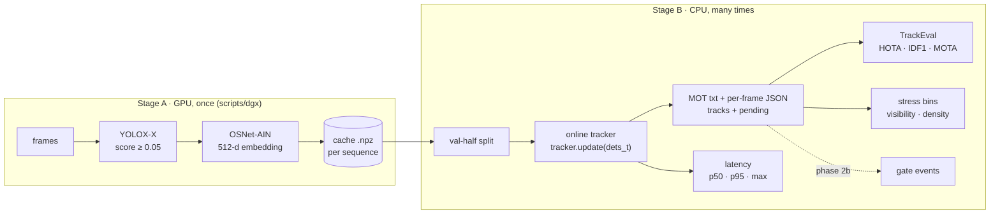

# zed-ps2-tracker

**Identity-preserving, strictly online multi-person tracking through dense occlusion.**
This is Zed Digital problem statement 2 (PS-2): every person crossing a crowded gate should keep
**one ID from approach to exit**, even when they are hidden behind someone else for a while.

> **Status: phase 1 complete.** Built so far:
> * the tracker core (a ByteTrack-style baseline on our own typed components);
> * the full evaluation stack (TrackEval, stress bins, latency, visibility oracle);
> * the GPU Stage A pipeline with a DGX runbook;
> * the documentation.
>
> The novel components (visibility estimate, ambiguity-aware delayed assignment) are specified
> in [docs/algorithm.md](docs/algorithm.md) and come in phase 2. All numbers below are **real
> and labelled**. No result in this README uses our method yet.

## Why this matters for Zed's gate products

The crowded gate is the scene of Zed's **ZIG** hands-free ticketing and validation platform:

| ZIG use | What it needs from the tracker | What breaks it |
|---|---|---|
| **Hands-free validation** (bus, rail, BRT) and **Fast Lane** venue entry | a validated ticket stays attached to the right body all the way through the gate | an ID switch hands one person's validation to someone else |
| **Tailgating / fare-evasion control** | two bodies on one validation are seen as two distinct IDs crossing close together | an ID *merge* hides a tailgater; an ID *split* invents a phantom one |
| **Passenger counting** | one crossing per person per direction | fragmented tracks double-count; merged tracks under-count |
| **Privacy** | identity without identification | the design keeps short-lived, in-memory body embeddings only: no faces, no stored identities |

So the metrics we care about are **identity metrics** (IDF1, HOTA, ID switches) under occlusion
and crowding, plus **gate events** (counting, attribution and tailgating errors, phase 2b). Raw
detection accuracy matters less.

## Architecture



* **Stage A** runs the detector and re-ID model once over every frame on the DGX and stores a
  compact cache. It keeps every detection down to confidence 0.05, each with its embedding.
* **Stage B** runs the tracker, evaluation and ablations on CPU from that cache. Every config
  therefore sees identical detections, and a change in score is a change in *tracking*.

Details: [docs/architecture.md](docs/architecture.md) and [docs/algorithm.md](docs/algorithm.md).

## Quickstart

```bash
git clone https://github.com/panshularora/zed-ps2-tracker && cd zed-ps2-tracker
make setup        # .venv with Python 3.11 (uv) + package + dev tools
make check        # ruff + mypy (strict on tracker/) + 120 tests
make data         # MOT17 + MOT20 labels and public detections only (no images, ~30 MB)
make smoke        # MOT17 train (full) + val-half with public dets: TrackEval + stress + latency
```

Run any config on any split (outputs go to `outputs/<DATASET>_<SPLIT>/`):

```bash
make eval    DATASET=MOT17 SPLIT=val_half CONFIG=configs/baselines/bytetrack.yaml NAME=bt
make eval    DATASET=MOT20 CONFIG=configs/baselines/bytetrack_mot20.yaml DETS=<cache dir>
make latency DATASET=MOT17 SPLIT=full
make oracle  DATASET=MOT17          # visibility-0 ceiling
python -m tracker.cli --caches <cache dir> --config configs/baselines/bytetrack.yaml \
    --out results/x --jsonl          # MOT txt + per-frame JSON (tracks + pending)
```

The GPU side is in [docs/dgx_guide.md](docs/dgx_guide.md): `bash scripts/dgx/setup.sh`, one
`run.sh` per dataset, then `finalize.sh`.

## Results (phase 1)

### Pipeline check: public FRCNN detections, IoU-only, MOT17 train

> **Read this first.** These numbers use MOTChallenge's **public FRCNN detections** and the
> **IoU-only ByteTrack-like baseline** (`configs/baselines/bytetrack.yaml`, ByteTrack code
> defaults, no re-ID, no per-sequence tuning, no interpolation). They show that the pipeline
> (split, tracker, TrackEval, stress, latency) works end to end on real data. They are **not**
> comparable to published ByteTrack numbers, which use YOLOX detections, and they are not our
> method. Scored with TrackEval (`BENCHMARK=MOT17`). Reproduce with `make smoke`.

**MOT17 train, all frames (7 FRCNN sequences, 5,316 frames)**

| Sequence | HOTA | IDF1 | MOTA | IDs | FP | FN | GT |
|---|---|---|---|---|---|---|---|
| MOT17-02 | 34.8 | 39.7 | 32.4 | 49 | 149 | 12,356 | 18,581 |
| MOT17-04 | 53.0 | 61.1 | 54.0 | 41 | 18 | 21,795 | 47,557 |
| MOT17-05 | 42.9 | 52.7 | 48.2 | 29 | 72 | 3,481 | 6,917 |
| MOT17-09 | 49.0 | 56.6 | 54.8 | 17 | 11 | 2,381 | 5,325 |
| MOT17-10 | 41.3 | 46.0 | 51.4 | 204 | 592 | 5,448 | 12,839 |
| MOT17-11 | 51.9 | 57.5 | 56.6 | 39 | 137 | 3,921 | 9,436 |
| MOT17-13 | 47.0 | 55.6 | 48.9 | 143 | 587 | 5,215 | 11,642 |
| **Combined** | **47.7** | **54.5** | **49.5** | **522** | 1,566 | 54,597 | 112,297 |

**MOT17 val-half** (the split all later results use; frames N//2+2..N): HOTA **50.1**, IDF1
**56.3**, MOTA **47.5**, IDs **191** (GT 53,890). Per-sequence numbers are in
`outputs/MOT17_val_half/metrics/`.

**Stress bins** (same run, MOT17 train). Bin totals are verified equal to TrackEval's.

| gt visibility | GT boxes | Recall | ID recall | IDs | IDs / 1k GT |
|---|---|---|---|---|---|
| 0.00–0.25 | 26,469 (23.6%) | 1.0% | 1.1% | 15 | 0.57 |
| 0.25–0.50 | 19,435 (17.3%) | 3.0% | 1.9% | 37 | 1.90 |
| 0.50–0.75 | 18,098 (16.1%) | 60.6% | 41.2% | 231 | 12.76 |
| 0.75–1.00 | 48,295 (43.0%) | 95.0% | 80.0% | 239 | 4.95 |

| People per frame | Frames | MOTA | IDF1 | IDs | IDs / 1k GT |
|---|---|---|---|---|---|
| 0–8 | 970 | 61.0 | 61.2 | 22 | 3.45 |
| 9–15 | 1,663 | 53.0 | 54.8 | 90 | 4.99 |
| 16–32 | 1,315 | 45.2 | 48.7 | 336 | 11.37 |
| 33+ | 1,368 | 49.4 | 56.7 | 74 | 1.27 |

What these numbers say:

* Below 50% visibility, the public detector barely fires (recall ≤ 3%).
* ID switches concentrate in the half-visible band (0.5–0.75), where boxes flicker in and out,
  and in moderately crowded frames.
* This is the failure regime that the phase-2 visibility estimate and delayed assignment target.

**Latency** (tracker `update()` only, single thread `OMP_NUM_THREADS=1`, Intel Xeon (VM, model
string "Intel(R) Xeon(R) Processor"), Python 3.11, NumPy 2.4, 3 timed passes over MOT17 train =
15,948 frames):

| p50 | p95 | p99 | max | frames > 10 ms |
|---|---|---|---|---|
| 0.92 ms | **1.90 ms** | 2.12 ms | **40.7 ms** | 4 of 15,948 |

The max comes from isolated spikes on a shared VM. Four of the seven sequences have maxima of
1.6–2.9 ms; each of the other three has single-frame spikes of 19.5–40.7 ms. The densest sequence (MOT17-04, 27 dets/frame) has p95 2.1 ms.

### Ceiling: the visibility-0 cap

MOT17/MOT20 gt includes people who are **fully hidden** (visibility 0; 11% of MOT17 val-half),
and TrackEval scores them. Submitting the gt itself with only the visible boxes (a perfect
detector and perfect identities that never coast) gives:

| Oracle | HOTA | IDF1 | MOTA |
|---|---|---|---|
| MOT17 val-half, gt boxes with vis > 0 | 91.1 | 94.2 | 89.1 |
| MOT20 val-half, gt boxes with vis > 0 | 97.3 | 98.4 | 96.9 |

### Not yet available

* **YOLOX-based results** for MOT17/MOT20/DanceTrack. These need the Stage A caches from the DGX.
* **MOT20 public-detection numbers:** MOT20's public detections carry confidences that are
  almost all 0/1, so a score-thresholded tracker discards nearly all of them.
* **MOTChallenge test numbers:** the server is offline (archive notice of 16 Apr 2026). Published
  test-leaderboard numbers will only ever appear in a separate table. See
  [docs/evaluation.md](docs/evaluation.md).

## How to reproduce

1. `make setup && make data && make smoke` reproduces every number above (≈ 1 min on 8 CPUs).
   CI pins MOT17-09 val-half (HOTA 52.7 / IDF1 59.5 / MOTA 51.6 / 5 IDs) as a regression test.
2. Stage A on a GPU: see [docs/dgx_guide.md](docs/dgx_guide.md). Bring back
   `bring_back/` and check `sha256sum -c SHA256SUMS`.
3. Stage B from caches: `make eval DETS=<bring_back>/cache/MOT17/ablation/train NAME=...`.
   `run.json` next to each result records the config, git commit, inputs and whether the
   detector saw the eval half.

## Documentation

| Doc | Contents |
|---|---|
| [docs/architecture.md](docs/architecture.md) | Stage A/B diagrams, one-frame data flow, interfaces, plug-in points |
| [docs/algorithm.md](docs/algorithm.md) | Kalman, costs, association, lifecycle FSM; planned visibility + delayed assignment (pseudocode) |
| [docs/modules.md](docs/modules.md) | every file |
| [docs/evaluation.md](docs/evaluation.md) | metrics, splits, no-test-server policy, stress and latency methods, online-only rule, leakage, vis-0 cap |
| [docs/dgx_guide.md](docs/dgx_guide.md) | GPU runbook and bring-back checklist |
| [docs/licenses.md](docs/licenses.md) | data / weights / code licences |
| [docs/decisions.md](docs/decisions.md) | ADRs |
| [docs/glossary.md](docs/glossary.md) | terms |
| [docs/roadmap.md](docs/roadmap.md) | phases 2a, 2b (gate events), 3, 4 |
| [docs/research/](docs/research/) | Research Lab briefs |
| [docs/integration/](docs/integration/), [demo/](demo/) | placeholders for the integration write-up, videos, deck and the static viewer |

## Licensing

Every benchmark dataset (MOT17, MOT20, DanceTrack videos, SOMPT22) is **non-commercial**, and
so are the public detector/re-ID weights trained on them. This repo is a research benchmark. The
tracker code depends only on NumPy, SciPy and PyYAML. TrackEval (MIT) is vendored with its
licence, and AGPL code (boxmot, Ultralytics) is deliberately avoided. Full details are in
[docs/licenses.md](docs/licenses.md).

The project's own code is licensed under the **Apache License 2.0**: see [LICENSE](LICENSE),
Copyright 2026 Panshul Arora. Ported code from ByteTrack, OC-SORT, BoT-SORT, Deep OC-SORT and
Hybrid-SORT, the vendored TrackEval, and the CMC files are all MIT. Their notices are kept in
[NOTICE](NOTICE). The Apache-2.0 licence does not cover the datasets or the detector/re-ID
weights, which remain **non-commercial research use only**.

## CI

The workflow lives in `ci/github-actions.yml`, because the token that created the repo lacks the
`workflow` scope. To enable it, add it through the GitHub UI as `.github/workflows/ci.yml`.
