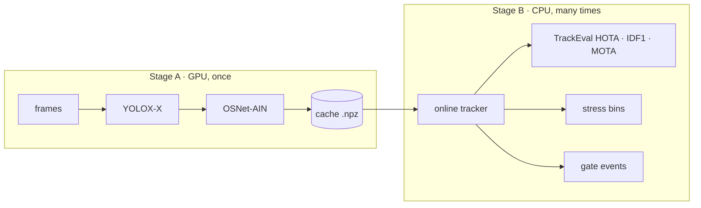

# zed-ps2-tracker

**Gate counter that keeps one ID per person.**

Zed Digital problem statement 2 (PS-2): identity-preserving, strictly online multi-person tracking through a crowded gate. Every person should keep **one ID from approach to exit**, even when they are hidden behind someone else.

**Live demo:** https://zed-ps2-tracker.vercel.app

**Demo video (Google Drive):** https://drive.google.com/drive/folders/1hPGca_j9OgOLtWjlsOP-xGHwSv46dQv_

**GitHub:** https://github.com/panshularora/zed-ps2-tracker

| Deliverable | File |
|---|---|
| Project report (Word) | [docs/report/Zed_PS2_Project_Report.docx](docs/report/Zed_PS2_Project_Report.docx) |
| Project report (PDF) | [docs/report/Zed_PS2_Project_Report.pdf](docs/report/Zed_PS2_Project_Report.pdf) |
| Slide deck (PPT) | [docs/presentation/Zed_PS2_Deck.pptx](docs/presentation/Zed_PS2_Deck.pptx) |
| Deck outline | [docs/deck_outline.md](docs/deck_outline.md) |

Author: **Panshul Arora**, SRM IST.

> **Headline.** The visibility rule **stops re-ID from hurting**. On MOT20 (SparseTrack detector) HOTA is ByteTrack 69.4 → ByteTrack + re-ID 67.5 → ours 69.5. It is **not** the best tracker overall: BoT-SORT (CMC, IoU) wins MOT17; Hybrid-SORT wins DanceTrack. ByteTrack paper MOTA is **not reproduced** (66.4 vs 76.6). Delayed assignment is a **NO-GO**. Both negatives are reported, not hidden.

---

## Links

- **Live app:** https://zed-ps2-tracker.vercel.app
- **Health (when the API is running):** `/api/health`
- **Demo video:** https://drive.google.com/drive/folders/1hPGca_j9OgOLtWjlsOP-xGHwSv46dQv_
- **Report:** [Word](docs/report/Zed_PS2_Project_Report.docx) · [PDF](docs/report/Zed_PS2_Project_Report.pdf)
- **Slides:** [PowerPoint](docs/presentation/Zed_PS2_Deck.pptx)

The public URL serves the React workstation (Dashboard, Gate scene, Scenarios, Studio, Results, Experiments, Analytics, Architecture). Scenarios, the gate scene, and Results use committed offline snapshots, so they work without a GPU. **Your video** (upload → draw a gate → CPU tracker) needs the FastAPI job service in `serve/` (local `uvicorn` or the Docker image).

---

## 1. Summary

At a ticket gate, a people counter is only as good as its IDs. If a person is hidden behind someone for a second and comes back with a new number, the gate can miss their crossing, count them twice, or hand their ticket to someone else.

This project builds:

1. a strictly **online** tracker that tries to keep one ID per person from approach to exit
2. a **gate-counting** layer on top of it
3. a **web app** that shows, honestly, where it works and where it fails

**Ours** is BoT-SORT plus a visibility rule: when a person's last box looked mostly hidden (estimated visibility below 0.7), the tracker remembers them three times longer (90 frames, 3 s at 30 fps, instead of 30). **Baseline** is ByteTrack with its code defaults. Both run from the same from-scratch `tracker/` code. Display code never relabels IDs.

### Key results (from the report)

- **Stress Map** (synthetic gate, 48 cells × 20 seeds): ours has fewer ID changes than ByteTrack in **24 of 48** cells and more in **14 of 48** (tie 4, unclear 6). Ours wins at every crowd size for hides of **1–2.5 s**; past **3 s** its memory runs out.
- **Longer memory** (opt-in `visibility_botsort_mem6.yaml`): better 36, worse 1, tie 1, unclear 10. Tuned on separate seeds; on real data it was checked on MOT17 only (HOTA 52.5 either way). **Not the default.**
- **MOT17-09 upload** (the only real clip with ground truth, CPU, YOLOX-S): truth **3 IN / 10 OUT**, tracker counted **4 IN / 11 OUT**. **9 of 15** counted crossings are real; **4** true crossings were missed.
- **Official benchmarks** (GPU detectors, provisional): visibility stops re-ID from hurting (MOT20 HOTA 69.4 → 67.5 → **69.5** ours; MOT17 62.5 → 63.2). BoT-SORT wins MOT17. Hybrid-SORT wins DanceTrack. ByteTrack MOTA 66.4 vs 76.6 published.
- **Delayed assignment:** pre-registered go/no-go **NO-GO** (all five checks failed). Dropped.

---

## 2. The problem

Zed's **ZIG** platform uses crowded gates for hands-free validation, Fast Lane entry, tailgating control and passenger counting. Each of these needs one body attached to one number:

| Gate use | What it needs from the tracker | What breaks it |
|---|---|---|
| Hands-free validation, Fast Lane entry | A validated ticket stays on the right body through the gate | An ID switch hands one person's validation to someone else |
| Tailgating / fare-evasion control | Two bodies on one validation are two distinct IDs | An ID merge hides a tailgater; a split invents a phantom |
| Passenger counting | One crossing per person per direction | Fragmented tracks double-count; merged tracks under-count |
| Privacy | Identity without identification | Stored faces or long-lived identities |

Three failure modes we measure:

1. **ID switch after a hide.** The detector loses the box, memory expires, the person comes back with a new number.
2. **Swap.** The same number comes back on a different person (example: subway-turnstile `#14`).
3. **Missed crossing.** The ID changes while the person is hidden on the line, so neither the old nor the new number crosses.

---

## 3. Our solution vs baseline

Same detector, smarter memory: we keep the person, not just the box.

| | ByteTrack (baseline) | Ours |
|---|---|---|
| Core tracker | ByteTrack | BoT-SORT + visibility rules |
| When someone is hidden | Drops them quickly (30-frame buffer) | Keeps their ID while they are likely just hidden (×3 buffer if last box vis &lt; 0.7 → 90 frames) |
| Matching on return | Position only | Position + camera-motion correction when a CMC file exists; appearance re-ID on GPU only |
| Proof | MOT tables below | 48 crowd/hiding cells, 20 seeds each, plus MOT17/MOT20/DanceTrack |
| Privacy | n/a | Tracking reads original frames in memory only; output blurs faces with an oval; the uploaded original is deleted after a successful job |

| Config | Builds on | Key settings | Status |
|---|---|---|---|
| `configs/baselines/bytetrack.yaml` | — | high 0.6 / low 0.1 / new 0.7; match 0.9; buffer 30; no appearance | Baseline everywhere |
| `configs/ours/visibility_botsort.yaml` | `botsort.yaml` | depth-order visibility × score; occluded_thresh 0.7; occluded_buffer_scale 3.0 | Default “ours” in app, API and stress suite |
| `configs/ours/visibility_botsort_mem6.yaml` | visibility_botsort | buffer scale 6.0 (180 frames) | Opt-in only |
| `configs/ours/delayed*.yaml` | ByteTrack (+ re-ID) | K-frame look-ahead | **NO-GO**; off by default |

MOT17 val-half, public FRCNN, CPU, no re-ID (pipeline check, not comparable to published YOLOX numbers):

| Tracker | HOTA | IDF1 | IDSW |
|---|---|---|---|
| ByteTrackLike (baseline) | 50.1 | 56.3 | 191 |
| BoT-SORT (CMC) | 51.6 | 58.8 | 197 |
| BoT-SORT, buffer 90 for every track (control) | 52.4 | 59.5 | 180 |
| **BoT-SORT + visibility (ours, default)** | **52.5** | **59.8** | **180** |
| BoT-SORT + visibility, longer memory (mem6) | 52.5 | 59.7 | 181 |

On public detections the visibility rule is about as good as a longer buffer for every track. Its intended use is gating appearance, which needs embeddings.

---

## 4. Architecture

```
Video (upload or demo clip)
  → YOLOX-S / YOLOX-tiny (CPU, onnxruntime, 640 input)
  → Tracker (BoT-SORT + visibility)
  → Gate logic (foot point, hysteresis, unsure flags)
  → FastAPI jobs API (serve/)
  → React app (web/) — 10 tabs
```

| Stage | What happens | Where |
|---|---|---|
| Video in | `POST /api/uploads` (mp4/mov/m4v/webm/mkv/avi, consent flag). Limits: 200 MB, 120 s, 1,800 tracked frames, 1 job worker | `serve/api.py` |
| Gate | User clicks two points on a face-blurred first frame | Studio step 4 |
| Detection | YOLOX (default `ZED_DETECTOR`; live image falls back to tiny if s is missing) | `serve/detector.py` |
| Tracking | `ours/visibility_botsort` on raw frames in memory. Re-ID off on CPU | `tracker/` |
| Gate logic | Crossing = box bottom-centre crosses the line with hysteresis. Low vis/score near the line is flagged unsure. Possible missed crossings are listed, never added to the count | `eval/gate_events.py`, `serve/analysis.py` |
| Outputs | Job status, tracks.csv, annotated.mp4, events.json | `serve/api.py` |
| Web app | Dashboard, Overview, What we use, Gate scene, Scenarios, Studio, Results, Experiments, Analytics, Architecture. Offline snapshot when the backend is down | `web/src/App.tsx` |

**Privacy.** Detection and tracking read unblurred frames in memory and never write them. Oval face blur is on output only (YuNet + a face-sized box at the top of every person box). The original upload is dropped after a **successful** job.

**Stage A / Stage B (research).** GPU detector + re-ID caches once (YOLOX-X, OSNet); CPU tracker ablations many times from those caches. Details: [docs/architecture.md](docs/architecture.md).



---

## 5. The app

Ten tabs. Numbers on Results/Overview come from this repo's own output files.

| Tab | What a judge sees |
|---|---|
| Dashboard / Overview | One-line goal, CPU MOT17 cards (ours IDF1 59.8, 180 ID switches, tracker p95 2.27 ms) |
| What we use | Detector, tracker configs, licenses |
| Gate scene | Synthetic two-person script with exact ground truth: ByteTrack vs ours |
| Scenarios | Face-blurred Pexels clips, labelled “Illustrative · no ground truth”. Watch IDs, including failures |
| Studio | Four steps: Watch the failure, Compare, Evidence, **Your video** (upload, consent, click two gate points, run) |
| Results | Stress Map (8×6 grid), GPU checks, ablation tables. Delayed assignment tagged sanity-check **NO-GO** |
| Experiments / Analytics | Ablations and gate-event notes |
| Architecture | Pipeline diagram |

**Break it yourself.** Click a Stress Map cell to replay that seed. Drag pillars or groups on the Gate scene; copy a shareable URL that rebuilds the same scene.

Your Video overlays a `#id` chip on **every** person in the upload playback.

| Overview | Demo (subway turnstile) |
|---|---|
|  |  |
| **Results** | **Architecture** |
|  |  |

---

## 6. Stress Map (synthetic gate)

Scene: 960×540 at 30 fps, counting line at y = 300. 8 hidden times (0.5–5 s) × 6 crowd sizes (5–40) = **48 cells**, 20 seeds (1000–1019), 960 runs per tracker. Verdict is better only when the bootstrap 95% CI excludes 0 and the sign test gives p &lt; 0.05.

Numbers are mean ID changes per clip, **ours / ByteTrack**. B = ours better, W = worse, T = tie, U = unclear.

| | 0.5 s | 1 s | 1.5 s | 2 s | 2.5 s | 3 s | 4 s | 5 s |
|---|---|---|---|---|---|---|---|---|
| 5 people | 1.0/1.1 T | 1.4/5.0 B | 1.7/5.0 B | 2.8/5.0 B | 3.0/5.0 B | 5.1/5.0 T | 5.2/5.0 T | 5.1/4.9 T |
| 10 people | 2.8/2.5 U | 3.5/10.5 B | 4.2/10.6 B | 5.3/10.3 B | 7.6/10.3 B | 10.9/10.2 W | 10.7/10.1 W | 10.4/10.0 U |
| 15 people | 4.5/3.9 U | 5.0/16.4 B | 7.1/16.1 B | 9.8/15.8 B | 10.0/15.8 B | 16.2/15.8 U | 16.1/15.2 W | 15.3/14.7 W |
| 20 people | 8.4/7.3 W | 9.1/22.5 B | 12.4/22.4 B | 12.6/21.4 B | 16.6/21.9 B | 22.7/21.6 W | 21.9/20.5 W | 20.7/19.4 W |
| 30 people | 15.9/15.0 U | 16.6/35.0 B | 20.2/35.1 B | 24.0/34.5 B | 26.8/33.5 B | 35.3/33.6 W | 33.9/31.8 W | 31.6/29.6 W |
| 40 people | 23.8/24.0 U | 27.4/51.1 B | 31.6/50.6 B | 33.6/48.9 B | 37.5/48.1 B | 49.3/46.9 W | 46.8/44.1 W | 43.4/40.5 W |

- All **24 “better”** cells are hides of 1–2.5 s at every crowd size. Example: 10 people hidden 1 s → 3.5 vs 10.5 ID changes, strict kept 6.6 vs 0.0 of 10.
- **14 worse** cells: 20 people at 0.5 s, and 13 of 18 cells at 3 s or more (memory expired).
- First divergence reason in 558 of 960 seeds: ByteTrack's 30-frame memory expired.
- Reproduce: `python -m eval.stress_run grid --seeds 20 --seed0 1000 --workers 6`

| Setting | Better | Worse | Tie | Unclear | Sum of mean ID changes |
|---|---|---|---|---|---|
| Ours default (`visibility_botsort`) | 24 | 14 | 4 | 6 | 786.7 |
| Ours longer memory (mem6, opt-in) | 36 | 1 | 1 | 10 | 726.1 |

---

## 7. MOT17-09 upload (real video, labels checked offline)

MOT17-09 (960×540, 525 frames, 30 fps) through Studio step 4. Gate clicked at (0.02, 0.65) → (0.98, 0.65). CPU, YOLOX-S. Ground truth is **never shown in the UI**.

| Measure | Value |
|---|---|
| True count (gt.txt, offline) | 3 IN / 10 OUT |
| Tracker count shown in the app | 4 IN / 11 OUT |
| Counted crossings that match a true one | 9 of 15 (precision 0.60) |
| True crossings the tracker missed | 4 |
| Possible missed crossings listed | 8, of which 1 is real |
| Unsure crossings listed | 10 |

The net count is close (off by +1 / +1) and hides errors on both sides: 6 false crossings and 4 missed ones. That is why the app shows only the tracker count, and lists suggestions as **moments worth checking**, never as an adjusted count.

---

## 8. Results (GPU, laptop): YOLOX-X + re-ID, provisional

One `run.sh all --profile laptop` on an RTX 3050 6 GB (16–18 Oct 2026), TrackEval on the val halves. Installed with `make ingest` into [docs/results/phase3/](docs/results/phase3/).

**Provisional:** our ByteTrack is 10.2 MOTA / 5.5 IDF1 below the ByteTrack paper on MOT17 (FP +2021, FN +3471, IDSW 165 vs 159). Comparisons between trackers on the **same** detections stay fair. Write-up: [docs/results/gpu/ANALYSIS.md](docs/results/gpu/ANALYSIS.md).

| Dataset (detector) | Tracker | HOTA | IDF1 | MOTA | IDSW | AssA |
|---|---|---|---|---|---|---|
| MOT17 val-half (`bytetrack_ablation`) | ByteTrackLike | 63.4 | 73.8 | 66.4 | 165 | 66.5 |
| | **BoT-SORT (CMC, IoU)** | **64.6** | **76.3** | **67.1** | 135 | **68.6** |
| | Deep OC-SORT | 63.3 | 74.6 | 64.6 | **125** | 68.2 |
| | ByteTrackLike + re-ID | 62.5 | 73.0 | 66.5 | 183 | 64.9 |
| | ours: ByteTrack + re-ID + visibility gate | 63.2 | 73.9 | 66.2 | 167 | 66.2 |
| | ours: BoT-SORT + re-ID + visibility gate | 63.9 | 75.1 | 66.8 | 156 | 67.1 |
| MOT20 val-half (`sparsetrack_ablation`) | ByteTrackLike | 69.4 | 84.1 | 87.9 | **1011** | 66.8 |
| | BoT-SORT (CMC, IoU) | 69.3 | 83.9 | 87.9 | 1162 | 66.5 |
| | ByteTrackLike + re-ID | 67.5 | 81.1 | 87.7 | 1278 | 63.5 |
| | **ours: ByteTrack + re-ID + visibility gate** | **69.5** | **84.5** | 87.9 | 1019 | **66.9** |
| | ours: BoT-SORT + re-ID + visibility gate | 69.2 | 84.0 | 87.9 | 1162 | 66.3 |
| MOT20 val-half (`bytetrack_x_mot17`) | ByteTrackLike | 60.8 | 76.8 | 79.6 | 1070 | 58.6 |
| | **Hybrid-SORT** | **62.9** | **79.9** | **82.6** | 1471 | **60.6** |
| | ours: ByteTrack + re-ID + visibility gate | 60.9 | 77.5 | 79.8 | **1039** | 58.8 |
| DanceTrack val (`dancetrack_bytetrack_x`) | ByteTrackLike | 52.5 | 54.9 | 88.1 | 1775 | 36.3 |
| | BoT-SORT (IoU) | 52.3 | 53.2 | 88.1 | 1934 | 35.9 |
| | **Hybrid-SORT** | **57.4** | **58.5** | 87.3 | **1667** | **42.9** |
| | ours: BoT-SORT + re-ID + visibility gate | 54.3 | 55.8 | 88.1 | 1897 | 38.8 |

**What we found: the visibility rule stops re-ID from hurting.** MOT20 SparseTrack: ByteTrack 69.4 HOTA → + re-ID 67.5 → ours **69.5**. MOT17: + re-ID 62.5 → ours 63.2. BoT-SORT without re-ID still beats ours on MOT17 (64.6 vs 63.9). Hybrid-SORT wins DanceTrack val (57.4 vs 54.3).

**A pre-registered idea we dropped (NO-GO).** Delayed decisions (K = 5 vs K = 0) failed all five pre-registered checks: IDSW 183 → 198 instead of −10 %, IDF1 73.0 → 71.9, fired on 51 % of frames (limit 10 %), p95 170 ms (limit 20 ms), MOT20 IDSW 1462 → 1575.

---

## 9. Results (phase 2): MOT17 val-half, public FRCNN, no re-ID

> Public detections with IoU-only association. **Not** comparable to published YOLOX numbers. Reproduce with `make ablate`. Details: [docs/results/ablation/](docs/results/ablation/).

| Tracker | HOTA | IDF1 | MOTA | IDSW | AssA | DetA | p50 / p95 / max ms |
|---|---|---|---|---|---|---|---|
| ByteTrackLike | 50.1 | 56.3 | 47.5 | 191 | 58.3 | 43.3 | 0.93 / 1.89 / 3.0 |
| OC-SORT | 49.8 | 56.2 | 46.0 | 154 | 59.4 | 41.9 | 0.73 / 1.55 / 2.6 |
| Deep OC-SORT (no emb, CMC) | 50.6 | 57.6 | 46.2 | **112** | 61.1 | 42.0 | 0.97 / 2.23 / 4.0 |
| Hybrid-SORT | 50.2 | 56.9 | 46.5 | 152 | 59.5 | 42.4 | 1.20 / 2.66 / 4.6 |
| BoT-SORT (CMC) | 51.6 | 58.8 | 48.0 | 197 | 61.0 | 43.9 | 0.95 / 1.92 / 2.9 |
| ByteTrackLike, buffer 90 (control) | 51.0 | 57.2 | 47.6 | 183 | 60.4 | 43.3 | 1.18 / 2.72 / 3.8 |
| ByteTrackLike + visibility | 51.0 | 57.3 | 47.6 | 183 | 60.4 | 43.3 | 1.07 / 2.19 / 3.6 |
| ByteTrackLike + delayed K=5 (near-online) | 48.8 | 54.3 | 47.4 | 215 | 55.6 | 43.0 | 1.26 / 18.00 / 69.5 |
| ByteTrackLike + visibility + delayed K=5 | 49.6 | 55.1 | 47.5 | 203 | 57.5 | 43.0 | 1.52 / 20.33 / 63.2 |
| **BoT-SORT + visibility** | **52.5** | **59.8** | 48.0 | 180 | **63.3** | 43.8 | 1.09 / 2.27 / 3.0 |
| BoT-SORT, buffer 90 (control) | 52.4 | 59.5 | 48.0 | 180 | 63.0 | 43.8 | 1.07 / 2.19 / 7.2 |

**Delayed assignment: NO-GO** ([docs/results/go_no_go.md](docs/results/go_no_go.md)). With K = 3/5/8, ID switches rise on every condition.

**Gate events** (`make gates`, 25 crossings / 9 tailgates on MOT17-02/04/09): crossing recall 56–60 %, attribution error 14–33 %, count error 28–40 %, tailgate P/R 80 / 44 %. Too few events to rank trackers.

**Visibility estimate** vs gt: MAE 0.074, Spearman 0.613, AUROC (v &lt; 0.5) 0.938. As a tracking signal on public dets it is indistinguishable from a 90-frame buffer.

---

## 10. Where we lose

- **Hidden longer than 3 s.** Memory runs out; worse than ByteTrack in 14 of 48 cells (1 of 48 with opt-in longer memory, checked on MOT17 only).
- **Short hides in big crowds.** 20 people at 0.5 s: 8.4 vs 7.3 ID changes.
- **DanceTrack.** Hybrid-SORT 57.4 HOTA vs ours 54.3.
- **Speed.** MOT20 ours p95 87–95 ms/frame vs 13.7 ms for ByteTrack (IoU).
- **Baseline not reproduced.** MOTA 66.4 vs 76.6, IDF1 73.8 vs 79.3 in the paper, so every GPU score is provisional.
- **CPU uploads.** Appearance re-ID is off, which causes false and missed crossings.
- **Keep-ID relabeller.** Deleted. It rewrote ours' new numbers back to old ones, so the “Ours” pane was not our tracker.

**Dropped on purpose.** Pre-registered delay-K failed all five checks (see §8).

---

## 11. How to run

### Live

Open **https://zed-ps2-tracker.vercel.app**. Gate scene, Scenarios and Results work there. For **Your video** (CPU detect + track):

```bash
python -m uvicorn serve.app:app --host 127.0.0.1 --port 8000
```

or `docker compose up --build` (see [deploy/README.md](deploy/README.md)). Render Blueprint: `render.yaml` (Docker, `$PORT`, YOLOX-tiny auto-download).

### Quickstart

```bash
git clone https://github.com/panshularora/zed-ps2-tracker && cd zed-ps2-tracker
make setup                 # .venv (Python 3.11) with the package + dev tools
make models clips blur     # ONNX models (sha256-checked), Pexels clips, face-blurred copies
make demo                  # API on :8000 + web app on http://localhost:5173
# or:
docker compose up --build  # web on :8080, API on :8000
make check && make test    # ruff + mypy + pytest, then vitest
```

### Windows (PowerShell)

```powershell
cd $HOME\Desktop\zed-ps2-tracker-main
py -3.11 -m venv .venv
.\.venv\Scripts\Activate.ps1
python -m pip install -U pip
python -m pip install -e ".[serve]" imageio-ffmpeg
python -m serve.detector fetch --out data\models
python -m uvicorn serve.app:app --host 127.0.0.1 --port 8000
```

Second window: `cd web; npm ci; npm run dev` → http://localhost:5173  
Or `npm run build` and use http://127.0.0.1:8000 (serves `web/dist`).

A fresh clone already plays Scenarios from committed 720p cuts in `web/public/demo/` (~11 MB). `make clips blur` is optional.

### Research commands

```bash
make data         # MOT17 + MOT20 labels and public detections (~30 MB, no images)
make smoke        # MOT17 train + val-half with public dets
make ablate       # ablation table + stress plots
make gates        # gate events on frozen MOT17 lines
make eval DATASET=MOT17 SPLIT=val_half CONFIG=configs/baselines/bytetrack.yaml NAME=bt
python -m eval.stress_run grid --seeds 20 --seed0 1000 --workers 6
```

GPU Stage A: [docs/dgx_runbook.md](docs/dgx_runbook.md), [docs/laptop_runbook.md](docs/laptop_runbook.md).

---

## 12. Documentation

| Doc | Contents |
|---|---|
| [docs/report/Zed_PS2_Project_Report.docx](docs/report/Zed_PS2_Project_Report.docx) | Full project report |
| [docs/presentation/Zed_PS2_Deck.pptx](docs/presentation/Zed_PS2_Deck.pptx) | 9-slide deck |
| [docs/architecture.md](docs/architecture.md) | Stage A/B diagrams, interfaces |
| [docs/algorithm.md](docs/algorithm.md) | Kalman, costs, association, visibility, delayed assignment |
| [docs/evaluation.md](docs/evaluation.md) | Metrics, splits, online-only rule, vis-0 cap |
| [docs/results/gpu/ANALYSIS.md](docs/results/gpu/ANALYSIS.md) | GPU run analysis |
| [docs/results/go_no_go.md](docs/results/go_no_go.md) | Delayed-assignment NO-GO |
| [docs/integration.md](docs/integration.md) | ZIG placement, event contract, pilot |
| [docs/demo_video_script.md](docs/demo_video_script.md) | Video shot list |
| [docs/licenses.md](docs/licenses.md) | Data / weights / code licences |
| [serve/README.md](serve/README.md) | CPU job service |
| [web/README.md](web/README.md) | Product frontend |
| [docs/glossary.md](docs/glossary.md) | Terms |

---

## 13. Licensing

Benchmark datasets (MOT17, MOT20, DanceTrack, SOMPT22) and public detector/re-ID weights are **non-commercial research use only**. Tracker code depends on NumPy, SciPy and PyYAML. TrackEval (MIT) is vendored. AGPL code (boxmot, Ultralytics) is avoided.

Project code: **Apache License 2.0**, Copyright 2026 Panshul Arora — [LICENSE](LICENSE). Ported ByteTrack / OC-SORT / BoT-SORT / Deep OC-SORT / Hybrid-SORT and TrackEval are MIT ([NOTICE](NOTICE)). Demo clips in `web/public/demo/` are Pexels License ([web/public/demo/LICENSE_CLIPS.md](web/public/demo/LICENSE_CLIPS.md)).

---

## 14. CI

Workflow: [`.github/workflows/ci.yml`](.github/workflows/ci.yml) (Python checks, web tests/build, Docker images, MOT17 regression). A copy also lives at [docs/ci/github-actions.yml](docs/ci/github-actions.yml).
