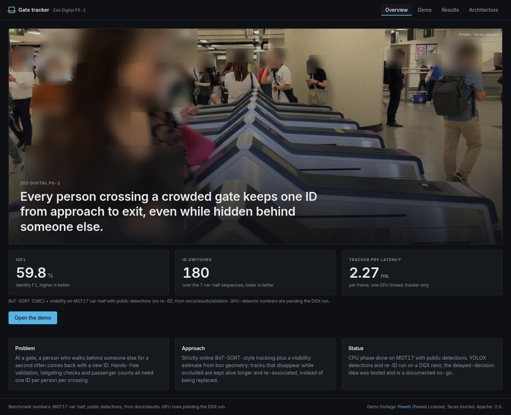
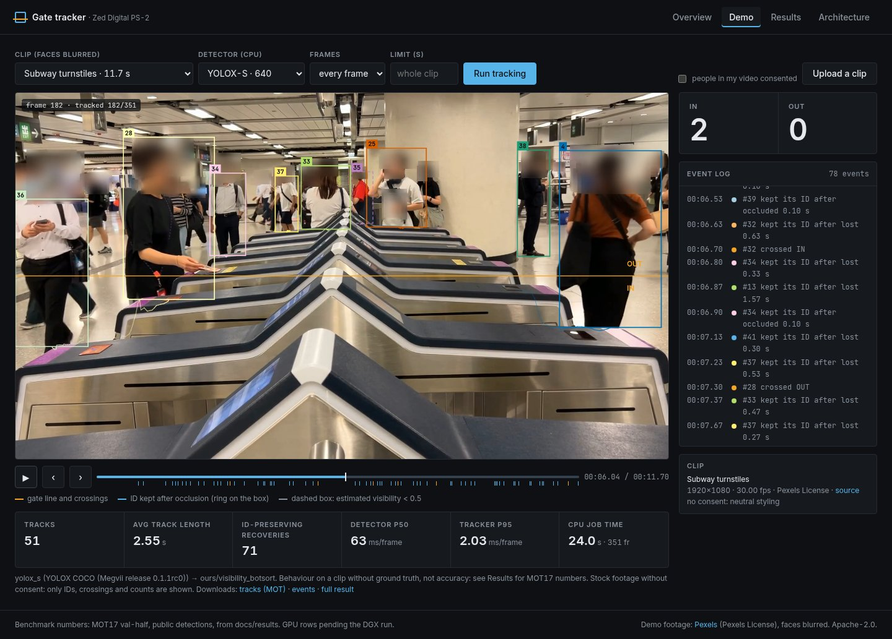
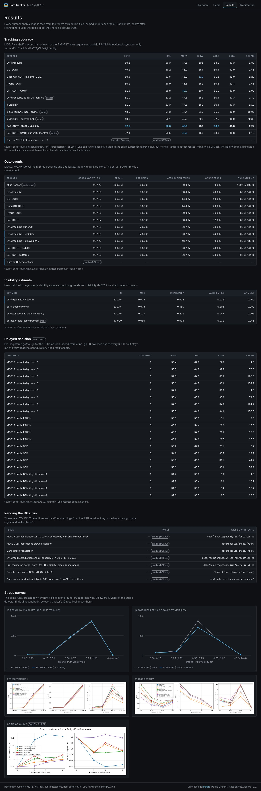
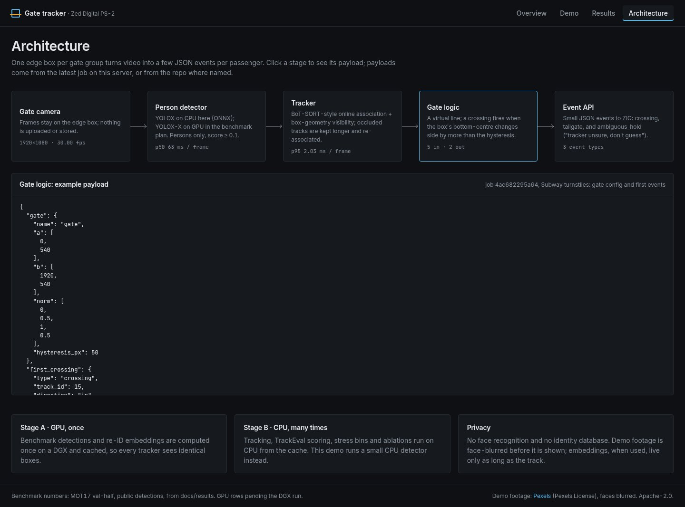
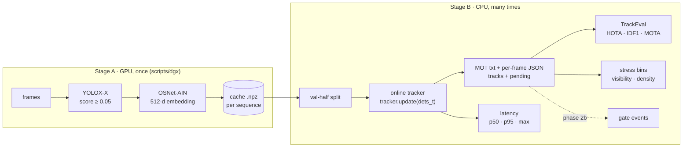
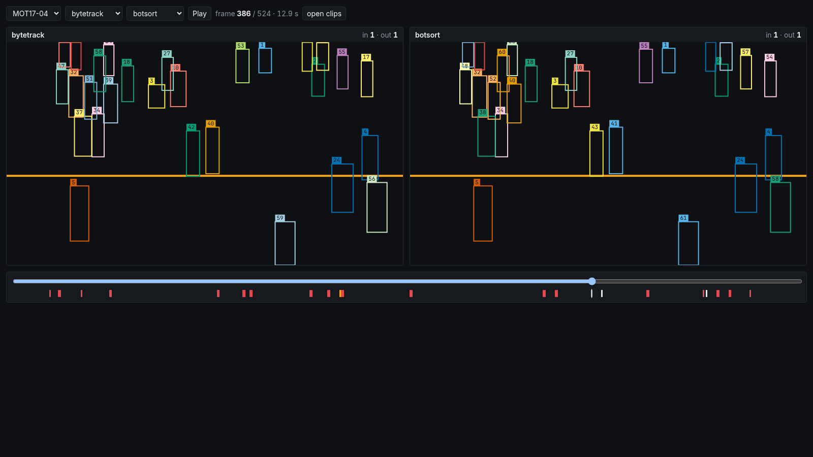
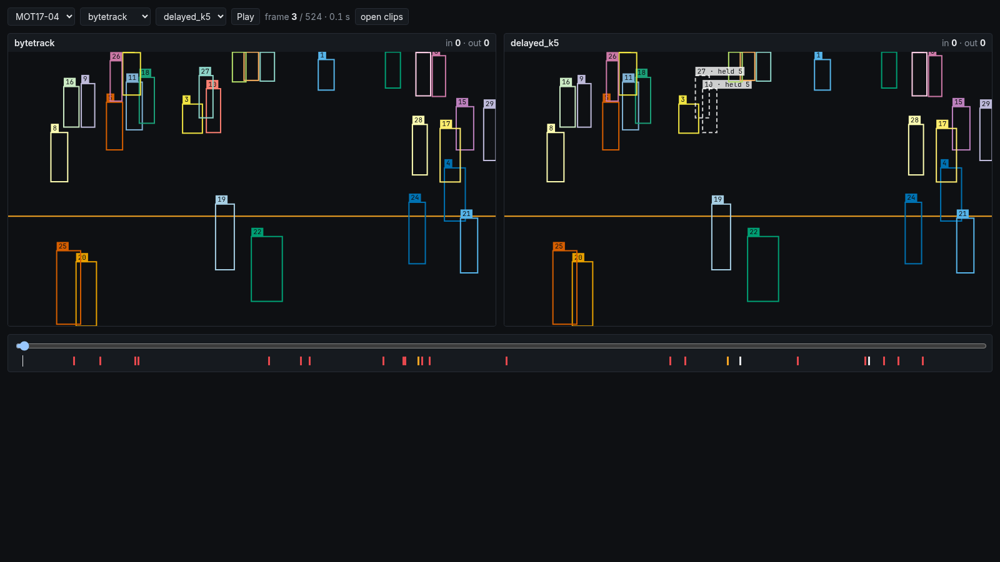
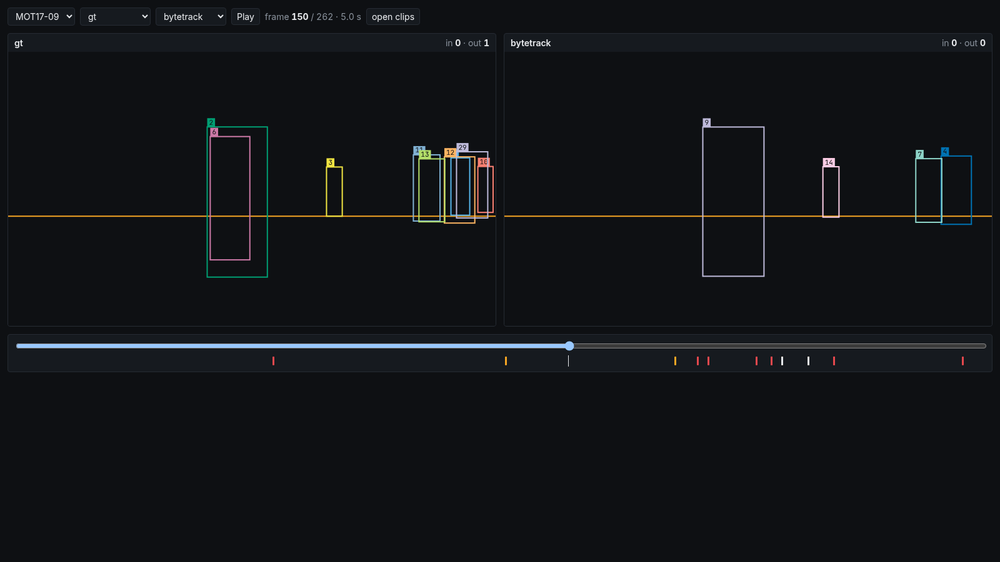

# zed-ps2-tracker

**Identity-preserving, strictly online multi-person tracking through dense occlusion.**
This is Zed Digital problem statement 2 (PS-2): every person crossing a crowded gate should keep
**one ID from approach to exit**, even when they are hidden behind someone else for a while.

> **Status: phase 2 done on CPU with public detections** (PRs #6–#13). Built so far:
> * five baselines ported to **exact upstream parity** (ByteTrack-like, OC-SORT, Deep OC-SORT,
>   Hybrid-SORT, BoT-SORT);
> * our two components, a depth-order **visibility estimate** and an ambiguity-aware **delayed
>   assignment**, both evaluated honestly;
> * `make ablate`, the gate-event metrics (`make gates`) and a static **viewer** (`make viewer`).
>
> **Headline:** on public detections without re-ID, visibility helps exactly as much as a longer
> buffer, and the delayed assignment is a **no-go**. Both are reported, not hidden. The next step
> is the GPU session, which brings YOLOX detections and re-ID: see
> [docs/next_gpu_session.md](docs/next_gpu_session.md). No number in this README uses YOLOX.

## Product demo (CPU): web app + job API

A React frontend over the `serve/` job API. Pick a face-blurred clip (or upload one), run the
tracker on CPU with a small YOLOX detector, and play it back with persistent IDs, trails, the
gate line and live in/out counters. Results and architecture pages read the same repo outputs as
this README. The **demo clips are not benchmarks**: no number from them appears in any results
table.

```bash
make setup                 # .venv (Python 3.11) with the package + dev tools
make models clips blur     # ONNX models (sha256-checked), 5 Pexels clips, face-blurred copies under data/demo/
make demo                  # API on :8000 + web app on http://localhost:5173 (Ctrl-C stops both)
# or, with Docker:
docker compose up --build  # web app on http://localhost:8080, API on :8000 (mounts data/models + data/demo/blurred)
```

| Overview | Demo (subway turnstile, after a CPU run) |
|---|---|
|  |  |
| **Results** | **Architecture** |
|  |  |

Measured on this repo's CPU box (x86_64 VM, 4 onnxruntime threads): the full 11.7 s turnstile
clip (351 frames at 1080p) with YOLOX-S took **24.2 s** end to end (detector p50 62.8 ms/frame,
tracker p95 2.0 ms/frame), started from the web UI. The Pexels clips have no consent from the people in them, so they are shown with
neutral styling only: IDs, crossings, counts and kept-ID recoveries, with no tailgating or
fare-evasion alerts ([docs/licenses.md](docs/licenses.md#demo-clips-pexels)). Details:
[web/README.md](web/README.md), [serve/README.md](serve/README.md).

## Why this matters for Zed's gate products

The crowded gate is the scene of Zed's **ZIG** hands-free ticketing and validation platform:

| ZIG use | What it needs from the tracker | What breaks it |
|---|---|---|
| **Hands-free validation** (bus, rail, BRT) and **Fast Lane** venue entry | a validated ticket stays attached to the right body all the way through the gate | an ID switch hands one person's validation to someone else |
| **Tailgating / fare-evasion control** | two bodies on one validation are seen as two distinct IDs crossing close together | an ID *merge* hides a tailgater; an ID *split* invents a phantom one |
| **Passenger counting** | one crossing per person per direction | fragmented tracks double-count; merged tracks under-count |
| **Privacy** | identity without identification | the design keeps short-lived, in-memory body embeddings only: no faces, no stored identities |

So the metrics we care about are **identity metrics** (IDF1, HOTA, ID switches) under occlusion
and crowding, plus **gate events** (counting, attribution and tailgating errors, phase 2b). Raw
detection accuracy matters less.

## Architecture



* **Stage A** runs the detector and re-ID model once over every frame on the DGX and stores a
  compact cache. It keeps every detection down to confidence 0.05, each with its embedding.
* **Stage B** runs the tracker, evaluation and ablations on CPU from that cache. Every config
  therefore sees identical detections, and a change in score is a change in *tracking*.

Details: [docs/architecture.md](docs/architecture.md) and [docs/algorithm.md](docs/algorithm.md).

Modules (file-by-file map in [docs/modules.md](docs/modules.md)):

* `tracker/`: the online tracker. Kalman, costs, assignment, lifecycle, gallery, `visibility.py`,
  `delayed.py`, `cmc.py`, `baselines/` (OC-SORT family, Hybrid-SORT), and `bytetrack.py`
  (ByteTrack-like, plus BoT-SORT via parity switches). NumPy + SciPy only, `mypy --strict`.
* `eval/`: splits, TrackEval, stress, latency, oracle, `ablate.py`, `go_no_go.py`, `corrupt.py`,
  `visibility_eval.py`, `gate_events.py`, `export_viewer.py`.
* `models/`, `scripts/dgx/`: Stage A on GPU. `viewer/`: static Vite/React viewer.
* `serve/`: FastAPI job service (clips, uploads, CPU detector, tracking jobs, benchmarks API,
  face blurring). `web/`: the React product frontend.

## Quickstart

```bash
git clone https://github.com/panshularora/zed-ps2-tracker && cd zed-ps2-tracker
make setup        # .venv with Python 3.11 (uv) + package + dev tools
make check        # ruff + mypy (strict on tracker/) + pytest (207 tests)
make test         # pytest + the web app's vitest
make data         # MOT17 + MOT20 labels and public detections only (no images, ~30 MB)
make smoke        # MOT17 train (full) + val-half with public dets: TrackEval + stress + latency
```

### Getting the demo videos

A fresh clone already plays the Scenarios tab: short 720p face-blurred cuts of each clip's tracked
range are committed in `web/public/demo/` (about 11 MB, made by `scripts/demo/make_demo_pack.sh`).
For the full-length clips, which are optional:

```bash
make models clips blur   # ONNX models, Pexels clips (data/demo/raw), face-blurred copies (data/demo/blurred)
make serve               # API on :8000 (serves only the blurred clips)
make web                 # build web/dist (or `make demo` for API + Vite dev server)
```

If a clip is missing, the player draws the boxes on a plain clip-shaped panel and shows
"Clip not downloaded on this machine. In ~/zed-ps2-tracker run: make clips blur  then reload."

Run any config on any split (outputs go to `outputs/<DATASET>_<SPLIT>/`):

```bash
make eval    DATASET=MOT17 SPLIT=val_half CONFIG=configs/baselines/bytetrack.yaml NAME=bt
make eval    DATASET=MOT20 CONFIG=configs/baselines/bytetrack_mot20.yaml DETS=<cache dir>
make latency DATASET=MOT17 SPLIT=full
make oracle  DATASET=MOT17          # visibility-0 ceiling
make ablate                         # ablation table + stress plots -> docs/results/ablation/
make gates                          # after make ablate: gate events on the frozen MOT17 lines
make viewer                         # export clips + build viewer/dist/index.html (needs Node 20)
make serve                          # CPU job API + built web app / viewer (FastAPI, `pip install -e .[serve]`)
make web                            # build the web app (web/dist); make demo runs API + dev server
make dashboard                      # same as make web; workstation at /dashboard/studio, /experiments, /evidence
make ingest BRING_BACK=<tar> DELETE=1   # DGX bundle -> data/stagea (sha256-checked), one tar at a time
make phase3                         # frozen phase-3 plan on the ingested caches -> docs/results/phase3/
make phase3-selftest                # the same chain on a synthetic bundle (~25 s)
python -m tracker.cli --caches <cache dir> --config configs/baselines/bytetrack.yaml \
    --out results/x --jsonl          # MOT txt + per-frame JSON (tracks + pending)
```

The GPU side is in [docs/dgx_runbook.md](docs/dgx_runbook.md) (checked, step by step) and
[docs/dgx_guide.md](docs/dgx_guide.md): `bash scripts/dgx/setup.sh`, one `run.sh` per dataset,
`finalize.sh`, then `pack.sh` → `scp` → `make ingest` → `make phase3`.

## Results (phase 2): MOT17 val-half, public FRCNN detections, no re-ID

> Same caveat as phase 1: these are public detections with IoU-only association, so they are
> **not** comparable to published YOLOX numbers. Latency is single-threaded `update()` time on
> the CPU box. Reproduce with `make ablate`. Details: [docs/results/ablation/](docs/results/ablation/).

| Tracker | HOTA | IDF1 | MOTA | IDSW | AssA | DetA | p50 / p95 / max ms |
|---|---|---|---|---|---|---|---|
| ByteTrackLike | 50.1 | 56.3 | 47.5 | 191 | 58.3 | 43.3 | 0.93 / 1.89 / 3.0 |
| OC-SORT | 49.8 | 56.2 | 46.0 | 154 | 59.4 | 41.9 | 0.73 / 1.55 / 2.6 |
| Deep OC-SORT (no emb, CMC) | 50.6 | 57.6 | 46.2 | **112** | 61.1 | 42.0 | 0.97 / 2.23 / 4.0 |
| Hybrid-SORT | 50.2 | 56.9 | 46.5 | 152 | 59.5 | 42.4 | 1.20 / 2.66 / 4.6 |
| BoT-SORT (CMC) | 51.6 | 58.8 | 48.0 | 197 | 61.0 | 43.9 | 0.95 / 1.92 / 2.9 |
| ByteTrackLike, buffer 90 (control) | 51.0 | 57.2 | 47.6 | 183 | 60.4 | 43.3 | 1.18 / 2.72 / 3.8 |
| ByteTrackLike + visibility | 51.0 | 57.3 | 47.6 | 183 | 60.4 | 43.3 | 1.07 / 2.19 / 3.6 |
| ByteTrackLike + delayed K=5 (near-online) | 48.8 | 54.3 | 47.4 | 215 | 55.6 | 43.0 | 1.26 / 18.00 / 69.5 |
| ByteTrackLike + visibility + delayed K=5 | 49.6 | 55.1 | 47.5 | 203 | 57.5 | 43.0 | 1.52 / 20.33 / 63.2 |
| BoT-SORT + visibility | **52.5** | **59.8** | 48.0 | 180 | **63.3** | 43.8 | 1.09 / 2.27 / 3.0 |
| BoT-SORT, buffer 90 (control) | 52.4 | 59.5 | 48.0 | 180 | 63.0 | 43.8 | 1.07 / 2.19 / 7.2 |

Stress plots by gt visibility and by density:
[stress_visibility.png](docs/results/ablation/stress_visibility.png),
[stress_density.png](docs/results/ablation/stress_density.png).

**Visibility estimate** (`tracker/visibility.py`, scored against gt column 9 by
[docs/results/visibility/](docs/results/visibility/)): MAE 0.074, Spearman 0.613, AUROC
(v < 0.5) 0.938, AP 0.460. The detector score alone gives MAE 0.107 / Spearman 0.429 / AUROC
0.947 / AP 0.293. As a tracking signal it is **indistinguishable from a 90-frame buffer** (rows
above). Its intended use, gating appearance updates, needs embeddings and is not yet tested.

**Delayed assignment: NO-GO** ([docs/results/go_no_go.md](docs/results/go_no_go.md), criteria
fixed in advance). With K = 3/5/8, ID switches rise on every condition. Corrupted gt (seed 0):
273 → 375/395/389. FRCNN: 191 → 212/215/217. SDP: 291 → 335/311/339. DPM: 89 → 90/94/97. HOTA is
lower or within ±0.2. p95 compute rises from 2–4 ms to 13–157 ms, plus the K/fps output delay.
It stays out of any headline configuration.

**Gate events** (`make gates`, lines frozen in `configs/gates/mot17_val_half.yaml`, details in
[docs/results/gate_events/](docs/results/gate_events/)). The check run, gt as tracker, scores 0
error. Baselines reach crossing recall 56–60 %, attribution error 14–33 %, count error 28–40 %
and tailgate P/R 80 / 44 %. MOT17-02/04/09 contain only **25 crossings and 9 tailgates**, too few
to rank trackers, so the gate clip from the GPU session is needed.

**Viewer** (`make viewer` → single-file `viewer/dist/index.html`, opens offline). It draws real
frames under the boxes when given an MP4 or JPEGs, synced with `requestVideoFrameCallback`
(tested in headless Chrome, `npm run e2e:media`); the screenshots below are still on a blank
canvas until the DGX clips come back:

| ByteTrack vs BoT-SORT, MOT17-04 | held decisions (delayed K=5) | gt vs ByteTrack, MOT17-09 |
|---|---|---|
|  |  |  |

Implementation deviations, pitfalls and negative results:
[docs/implementation_notes.md](docs/implementation_notes.md).

## Results (phase 1)

### Pipeline check: public FRCNN detections, IoU-only, MOT17 train

> **Read this first.** These numbers use MOTChallenge's **public FRCNN detections** and the
> **IoU-only ByteTrack-like baseline** (`configs/baselines/bytetrack.yaml`, ByteTrack code
> defaults, no re-ID, no per-sequence tuning, no interpolation). They show that the pipeline
> (split, tracker, TrackEval, stress, latency) works end to end on real data. They are **not**
> comparable to published ByteTrack numbers, which use YOLOX detections, and they are not our
> method. Scored with TrackEval (`BENCHMARK=MOT17`). Reproduce with `make smoke`.

**MOT17 train, all frames (7 FRCNN sequences, 5,316 frames)**

| Sequence | HOTA | IDF1 | MOTA | IDs | FP | FN | GT |
|---|---|---|---|---|---|---|---|
| MOT17-02 | 34.8 | 39.7 | 32.4 | 49 | 149 | 12,356 | 18,581 |
| MOT17-04 | 53.0 | 61.1 | 54.0 | 41 | 18 | 21,795 | 47,557 |
| MOT17-05 | 42.9 | 52.7 | 48.2 | 29 | 72 | 3,481 | 6,917 |
| MOT17-09 | 49.0 | 56.6 | 54.8 | 17 | 11 | 2,381 | 5,325 |
| MOT17-10 | 41.3 | 46.0 | 51.4 | 204 | 592 | 5,448 | 12,839 |
| MOT17-11 | 51.9 | 57.5 | 56.6 | 39 | 137 | 3,921 | 9,436 |
| MOT17-13 | 47.0 | 55.6 | 48.9 | 143 | 587 | 5,215 | 11,642 |
| **Combined** | **47.7** | **54.5** | **49.5** | **522** | 1,566 | 54,597 | 112,297 |

**MOT17 val-half** (the split all later results use; frames N//2+2..N): HOTA **50.1**, IDF1
**56.3**, MOTA **47.5**, IDs **191** (GT 53,890). Per-sequence numbers are in
`outputs/MOT17_val_half/metrics/`.

**Stress bins** (same run, MOT17 train). Bin totals are verified equal to TrackEval's.

| gt visibility | GT boxes | Recall | ID recall | IDs | IDs / 1k GT |
|---|---|---|---|---|---|
| 0.00–0.25 | 26,469 (23.6%) | 1.0% | 1.1% | 15 | 0.57 |
| 0.25–0.50 | 19,435 (17.3%) | 3.0% | 1.9% | 37 | 1.90 |
| 0.50–0.75 | 18,098 (16.1%) | 60.6% | 41.2% | 231 | 12.76 |
| 0.75–1.00 | 48,295 (43.0%) | 95.0% | 80.0% | 239 | 4.95 |

| People per frame | Frames | MOTA | IDF1 | IDs | IDs / 1k GT |
|---|---|---|---|---|---|
| 0–8 | 970 | 61.0 | 61.2 | 22 | 3.45 |
| 9–15 | 1,663 | 53.0 | 54.8 | 90 | 4.99 |
| 16–32 | 1,315 | 45.2 | 48.7 | 336 | 11.37 |
| 33+ | 1,368 | 49.4 | 56.7 | 74 | 1.27 |

What these numbers say:

* Below 50% visibility, the public detector barely fires (recall ≤ 3%).
* ID switches concentrate in the half-visible band (0.5–0.75), where boxes flicker in and out,
  and in moderately crowded frames.
* This is the failure regime that the phase-2 visibility estimate and delayed assignment target.

**Latency** (tracker `update()` only, single thread `OMP_NUM_THREADS=1`, Intel Xeon (VM, model
string "Intel(R) Xeon(R) Processor"), Python 3.11, NumPy 2.4, 3 timed passes over MOT17 train =
15,948 frames):

| p50 | p95 | p99 | max | frames > 10 ms |
|---|---|---|---|---|
| 0.92 ms | **1.90 ms** | 2.12 ms | **40.7 ms** | 4 of 15,948 |

The max comes from isolated spikes on a shared VM. Four of the seven sequences have maxima of
1.6–2.9 ms; each of the other three has single-frame spikes of 19.5–40.7 ms. The densest sequence (MOT17-04, 27 dets/frame) has p95 2.1 ms.

### Ceiling: the visibility-0 cap

MOT17/MOT20 gt includes people who are **fully hidden** (visibility 0; 11% of MOT17 val-half),
and TrackEval scores them. Submitting the gt itself with only the visible boxes (a perfect
detector and perfect identities that never coast) gives:

| Oracle | HOTA | IDF1 | MOTA |
|---|---|---|---|
| MOT17 val-half, gt boxes with vis > 0 | 91.1 | 94.2 | 89.1 |
| MOT20 val-half, gt boxes with vis > 0 | 97.3 | 98.4 | 96.9 |

### Not yet available

* **YOLOX-based results** for MOT17/MOT20/DanceTrack. These need the Stage A caches from the DGX.
* **MOT20 public-detection numbers:** MOT20's public detections carry confidences that are
  almost all 0/1, so a score-thresholded tracker discards nearly all of them.
* **MOTChallenge test numbers:** the server is offline (archive notice of 16 Apr 2026). Published
  test-leaderboard numbers will only ever appear in a separate table. See
  [docs/evaluation.md](docs/evaluation.md).

## How to reproduce

1. `make setup && make data && make smoke` reproduces every number above (≈ 1 min on 8 CPUs).
   CI pins MOT17-09 val-half (HOTA 52.7 / IDF1 59.5 / MOTA 51.6 / 5 IDs) as a regression test.
2. Stage A on a GPU: see [docs/dgx_runbook.md](docs/dgx_runbook.md). Pack with
   `scripts/dgx/pack.sh`, copy the tars back, and `make ingest BRING_BACK=<tar>` each one
   (sha256-checked against SHA256SUMS); then `make phase3`.
3. Stage B from caches: `make eval DETS=<bring_back>/cache/MOT17/ablation/train NAME=...`.
   `run.json` next to each result records the config, git commit, inputs and whether the
   detector saw the eval half.

## Roadmap

1. **GPU session** ([docs/next_gpu_session.md](docs/next_gpu_session.md)): YOLOX detections and
   re-ID caches; re-run `make ablate` and the go/no-go on them; visibility-gated appearance;
   delayed look-ahead with re-ID; MOT20 / DanceTrack; the gate clip.
2. **Integration:** proposal [docs/integration.md](docs/integration.md) (edge box, gate-event
   contract, pilot), CPU job service `serve/` + web app `web/` (docker-compose), video script
   [docs/demo_video_script.md](docs/demo_video_script.md) and deck outline
   [docs/deck_outline.md](docs/deck_outline.md); GPU numbers are placeholders until phase 3. Full table in [docs/roadmap.md](docs/roadmap.md).

## Documentation

| Doc | Contents |
|---|---|
| [docs/architecture.md](docs/architecture.md) | Stage A/B diagrams, one-frame data flow, interfaces, plug-in points |
| [docs/algorithm.md](docs/algorithm.md) | Kalman, costs, association, lifecycle FSM; planned visibility + delayed assignment (pseudocode) |
| [docs/modules.md](docs/modules.md) | every file |
| [docs/evaluation.md](docs/evaluation.md) | metrics, splits, no-test-server policy, stress and latency methods, online-only rule, leakage, vis-0 cap |
| [docs/dgx_runbook.md](docs/dgx_runbook.md) | checked step-by-step DGX runbook (setup → pack → scp → ingest) |
| [docs/dgx_guide.md](docs/dgx_guide.md) | GPU background and bring-back checklist |
| [docs/preregistration/](docs/preregistration/) | go/no-go v2 rule, frozen before the GPU data |
| [docs/integration.md](docs/integration.md) | product proposal for ZIG: placement, event contract, gains, limits, pilot |
| [docs/demo_video_script.md](docs/demo_video_script.md), [docs/deck_outline.md](docs/deck_outline.md) | video shot list, deck outline |
| [serve/README.md](serve/README.md) | CPU job service: clips, uploads, jobs, events, metrics, errors, env vars |
| [web/README.md](web/README.md) | the product frontend (overview, demo, results, architecture) |
| [docs/implementation_notes.md](docs/implementation_notes.md) | deviations from upstream, pitfalls, negative results |
| [docs/next_gpu_session.md](docs/next_gpu_session.md) | what to run on the GPU next, and why |
| [docs/results/](docs/results/) | parity, visibility, go/no-go, ablation, gate events |
| [viewer/README.md](viewer/README.md) | the static viewer |
| [docs/licenses.md](docs/licenses.md) | data / weights / code licences |
| [docs/decisions.md](docs/decisions.md) | ADRs |
| [docs/glossary.md](docs/glossary.md) | terms |
| [docs/roadmap.md](docs/roadmap.md) | roadmap and status by phase |
| [docs/research/](docs/research/) | Research Lab briefs |
| [docs/integration/](docs/integration/) | remaining planned deliverables (walkthrough videos, deck) |
| [docs/status.md](docs/status.md) | what is done, what waits for the GPU, what was cut |

## Licensing

Every benchmark dataset (MOT17, MOT20, DanceTrack videos, SOMPT22) is **non-commercial**, and
so are the public detector/re-ID weights trained on them. This repo is a research benchmark. The
tracker code depends only on NumPy, SciPy and PyYAML. TrackEval (MIT) is vendored with its
licence, and AGPL code (boxmot, Ultralytics) is deliberately avoided. Full details are in
[docs/licenses.md](docs/licenses.md).

The project's own code is licensed under the **Apache License 2.0**: see [LICENSE](LICENSE),
Copyright 2026 Panshul Arora. Ported code from ByteTrack, OC-SORT, BoT-SORT, Deep OC-SORT and
Hybrid-SORT, the vendored TrackEval, and the CMC files are all MIT. Their notices are kept in
[NOTICE](NOTICE). The Apache-2.0 licence does not cover the datasets or the detector/re-ID
weights, which remain **non-commercial research use only**. Nor does it cover the demo clips in
`web/public/demo/` and stills in `web/public/thumbs/`: those are Pexels footage under the Pexels
License, listed with their sources in [web/public/demo/LICENSE_CLIPS.md](web/public/demo/LICENSE_CLIPS.md);
do not reuse them as stock.

## CI

The workflow lives in `docs/ci/github-actions.yml` (jobs: Python checks, web lint/typecheck/tests/
build, both Docker images, MOT17 regression), because the token that created the repo lacks the
`workflow` scope. To enable it, add it through the GitHub UI as `.github/workflows/ci.yml`.
