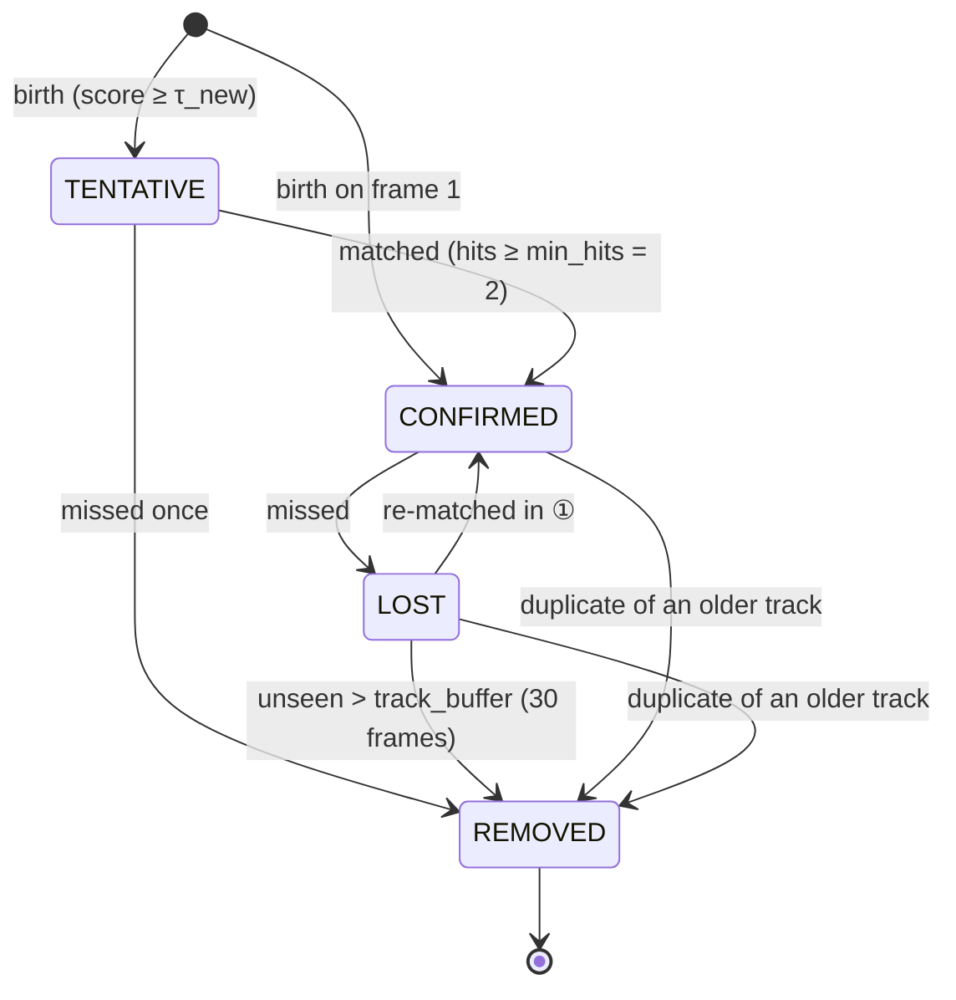

# Algorithm

This page specifies what the tracker computes. The first half documents the implemented
baseline (`ByteTrackLike`, phase 1); the second half specifies the two planned components
(phase 2) in pseudocode. Symbols match the config keys in `configs/baselines/bytetrack.yaml`.

## 1. Motion model: constant-velocity Kalman filter in xywh

`tracker/kalman.py`, following BoT-SORT's parameterisation.

State and measurement:

$$
\mathbf{x} = [c_x, c_y, w, h, \dot c_x, \dot c_y, \dot w, \dot h]^\top, \qquad
\mathbf{z} = [c_x, c_y, w, h]^\top
$$

Transition with $\Delta t = 1$ frame, and observation:

$$
F = \begin{bmatrix} I_4 & I_4 \\ 0 & I_4 \end{bmatrix}, \qquad H = [\,I_4 \;\; 0\,]
$$

Noise is proportional to the current box size, with $\sigma_p = 1/20$ and $\sigma_v = 1/160$:

$$
Q = \operatorname{diag}\big( (\sigma_p w)^2, (\sigma_p h)^2, (\sigma_p w)^2, (\sigma_p h)^2,
(\sigma_v w)^2, (\sigma_v h)^2, (\sigma_v w)^2, (\sigma_v h)^2 \big)
$$

$$
R = \operatorname{diag}\big( (\sigma_p w)^2, (\sigma_p h)^2, (\sigma_p w)^2, (\sigma_p h)^2 \big)
$$

Initialisation from a detection $\mathbf z$: $\mathbf x_0 = [\mathbf z, \mathbf 0]$ and
$P_0 = \operatorname{diag}\big((2\sigma_p\cdot)^2, (10\sigma_v\cdot)^2\big)$ with the same w/h
pattern.

Each frame:

$$
\begin{aligned}
\text{predict:}\quad & \mathbf x^- = F\mathbf x, & P^- &= F P F^\top + Q(\mathbf x) \\
\text{project:}\quad & \hat{\mathbf z} = H\mathbf x^-, & S &= H P^- H^\top + R(\mathbf x^-) \\
\text{update:}\quad & K = P^- H^\top S^{-1}, & \mathbf x &= \mathbf x^- + K(\mathbf z - \hat{\mathbf z}),\quad P = P^- - K S K^\top
\end{aligned}
$$

$K$ is computed through a Cholesky solve rather than an explicit inverse. For tracks that are
not currently matched (LOST), the size velocities $\dot w, \dot h$ are zeroed before predicting,
so an unobserved box does not grow or shrink without bound. ByteTrack itself uses DeepSORT's
`xyah` state; the difference is listed in [decisions.md](decisions.md#adr-004).

## 2. Costs

`tracker/cost.py`. Every cost is a distance in $[0, 1]$ (lower is better).

| Cost | Formula | Used in |
|---|---|---|
| IoU distance | $c_{\text{iou}}(i,j) = 1 - \operatorname{IoU}(\hat b_i, d_j)$ | all stages |
| Score fusion (ByteTrack) | $c = 1 - (1 - c_{\text{iou}})\, s_j$ | stage ① and ③ when `fuse_score` (off for MOT20) |
| Cosine distance | $c_{\text{app}}(i,j) = 1 - \cos(\mathbf e_i, \mathbf f_j)$ | only with `appearance.enabled` |
| IoU / re-ID fusion (BoT-SORT) | $\hat c_{\text{app}} = c_{\text{app}}/2$, set to 1 if $\hat c_{\text{app}} > \theta_{\text{app}}$ or $c_{\text{iou}} > \theta_{\text{prox}}$; $c = \min(c_{\text{motion}}, \hat c_{\text{app}})$ | stage ① and ③ with appearance |

$\mathbf e_i$ is the track's appearance memory (EMA of past embeddings,
$\mathbf e \leftarrow \alpha\mathbf e + (1-\alpha)\mathbf f$, re-normalised, $\alpha = 0.9$).
$\mathbf f_j$ is the detection's L2-normalised OSNet embedding.

## 3. Assignment

`tracker/assignment.py`. Pairs with cost above the stage threshold are forbidden. We solve a
rectangular linear assignment on an extended matrix whose dummy entries cost the threshold.
That is the same thresholding as ByteTrack's `lap.lapjv(cost, extend_cost=True,
cost_limit=thresh)`, and the scipy and lap backends agree on all tests.

## 4. Two-stage association (one frame)

```text
input: detections D_t (boxes, scores, embeddings?), live tracks T
D_high = {d : s_d >  τ_high}                      # 0.6
D_low  = {d : τ_low < s_d < τ_high}               # 0.1; s = τ_high is in neither set (ByteTrack)
predict every track in T with the Kalman filter

① pool = CONFIRMED ∪ LOST
  M1 = assign(cost(pool, D_high; score fusion, appearance if enabled), match_thresh = 0.9)
  update matched tracks (LOST → CONFIRMED on re-match)
② R = unmatched tracks of pool that are CONFIRMED
  M2 = assign(IoU cost(R, D_low), 0.5)
  unmatched in R → LOST;  unmatched LOST tracks age
③ U = TENTATIVE tracks, D_left = D_high not matched in ①
  M3 = assign(cost(U, D_left), 0.7);  unmatched tentative → REMOVED
④ births: d ∈ D_left unmatched in ③ with s_d ≥ τ_new (0.7) → new TENTATIVE track
  (CONFIRMED immediately on frame 1)
⑤ LOST tracks unseen for more than track_buffer frames → REMOVED
⑥ duplicate removal: a CONFIRMED and a LOST track with 1 − IoU < 0.15 → drop the younger one
output: CONFIRMED tracks updated this frame, area > 100 px² and w/h ≤ 1.6
```

Low-score detections are used **only** to keep existing confirmed tracks alive (②), which is
ByteTrack's central idea. They never start tracks and never use appearance. Under occlusion the
detector's score drops, so stage ② is what carries a person through partial occlusion.

## 5. Track lifecycle (FSM)

`tracker/lifecycle.py`. Transitions are validated; an illegal transition raises.



The ByteTrack baseline keeps the buffer at 30 frames whatever the frame rate
(`scale_buffer_by_fps: false`), because ByteTrack's evaluator never passes the frame rate. Ours
can scale it by `fps / 30`.

## 6. Planned: inference-time visibility estimate (phase 2)

Goal: estimate, for every detection in the current frame and from boxes alone, the fraction of
the person that is visible. The estimate is scored against the gt visibility column (it is a
contribution in its own right) and used to gate appearance.

Basis. The MOT gt visibility was itself computed from box overlaps with depth order taken from
the box bottom edge (MOTChallenge IJCV paper, App. C.1.5). The Research Lab reproduced it from gt
boxes (`scripts/research/vis_oracle_check.py`). At inference we have only **detections**, so the
estimate can be no better than the detector's view of who is occluding whom.

```text
function DEPTH_ORDER_VISIBILITY(boxes xyxy (N×4), image W×H):
    # closer = larger bottom edge y2 (camera above the ground plane, looking down)
    order = argsort(y2)                       # far → near
    for i in 0..N-1:
        mask = zeros(h_i × w_i)               # rasterised at reduced resolution for speed
        mark pixels of box i outside the image as hidden        # border cropping term
        for j with y2_j > y2_i:               # every closer box
            mark intersection(box_i, box_j) as hidden
        v_i = 1 − mean(mask)
    return v                                   # O(N²) worst case; vectorised in practice
```

Uses (each one can be switched off for the ablation):

```text
appearance update:  if v_d < v_min: do not update the track's embedding EMA
appearance weight:  ĉ_app ← ĉ_app scaled toward 1 as v_d → 0  (a hidden person's crop is mostly the occluder)
lifecycle:          a track lost while its last v < v_occ gets buffer × β (it is probably behind someone)
delayed trigger:    see §7
```

How it is scored: match detections to gt with IoU ≥ 0.5 and compare $v$ with gt column 9 (MAE,
Spearman, AUROC for $v < 0.5$ and $v < 0.25$), reporting coverage per visibility bin. The
reference baselines are the gt-box all-classes oracle and the pedestrians-only oracle. See
`docs/research/implementation_research.md` §2.4.

## 7. Planned: ambiguity-aware delayed assignment (phase 2)

A bounded-latency, MHT-style deferral: commit immediately when the match is clear, and hold the
decision open for at most K frames when two look-alike, partially hidden people are competing
for the same detections.

```text
state: open_clusters = {}               # each: tracks, hypotheses (≤ H_max), opened_frame
       emit_queue                       # frame results waiting for t − K

function UPDATE(D_t):
    run §4 up to the cost matrix C of stage ①
    for each track i:
        top1, top2 = two smallest entries of C[i, :]
        ambiguous_i = (top2 − top1 < margin) and (min visibility of the two candidates < v_amb)
    group ambiguous tracks that share candidate detections into clusters
    for cluster in clusters:
        if |cluster| > C_max or hypotheses would exceed H_max: commit greedily   # graceful fallback
        else: open or extend the cluster with hypotheses {keep, swap, one-missed}
              score each hypothesis by accumulated cost over its frames
              record PendingDecision(track, candidates, costs, opened, opened + K)
    assign every non-ambiguous track immediately (§4 unchanged)
    for cluster opened at t − K or whose candidates separated (IoU < ε):
        commit the best-scoring hypothesis, apply its updates to the Kalman filters and memories
    emit FrameResult_{t−K} (tracks as committed, pending = decisions still open at t−K)
    # never revise a frame after it is emitted; flush the last K frames at sequence end
```

Properties we report:

* **K = 0 must reproduce the baseline exactly** (unit-tested).
* Latency is fixed at K frames. For example, K = 4 is 133 ms at 30 fps and 160 ms at 25 fps; it
  is stated in frames and in ms per dataset.
* Branch count and live hypotheses (mean / max) are plotted against density to show that the
  cost stays bounded.
* Results go in a column labelled "K-frame-delayed online", separate from strictly online.

## 8. Online-only rule

The output for frame t is a function of frames 1..t only (1..t+K for the delayed variant,
labelled as such). There is no interpolation, no backward smoothing, no global tracklet
merging and no per-sequence tuning. ByteTrack's evaluator hard-codes per-sequence overrides:
`track_buffer` 14 for MOT17-05/06 and 25 for MOT17-13/14, plus `track_thresh` changes for
MOT17-01/06/12/14 and MOT20-06/08. Two of those sequences (05, 13) are in the val half. We do not
reproduce any of them.
