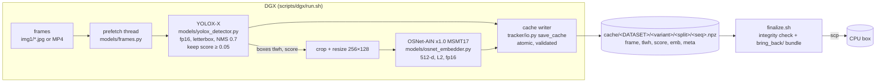
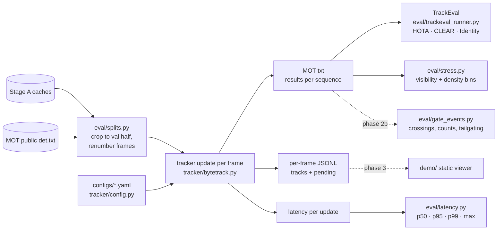
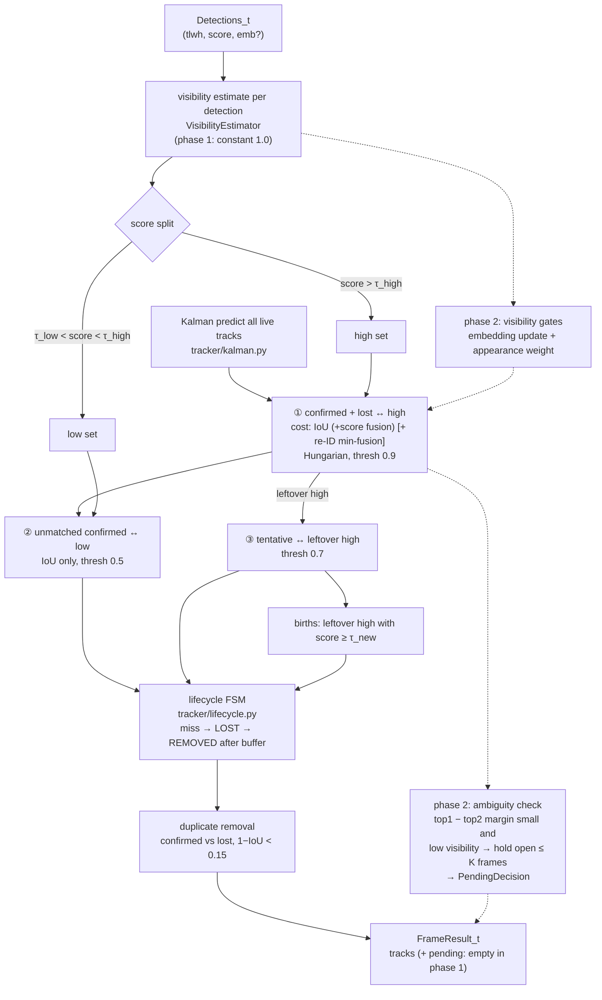

# Architecture

The system is split in two along the line between "needs a GPU" and "needs to be iterated on":

* **Stage A (GPU, run once on the DGX).** Detector + re-ID model over every frame, written to a
  compact per-sequence cache. Nothing in Stage A makes a tracking decision, and it filters
  nothing beyond a confidence floor of 0.05.
* **Stage B (CPU, run hundreds of times).** The tracker itself, evaluation, stress bins,
  ablations, latency and gate events, all reading the cache. One full MOT17 run plus TrackEval
  takes ~10 s on a laptop-class CPU.

This split is what makes a strictly online tracker cheap to study. Every ablation reuses the same
detections, so differences between configs are differences in **tracking**, not in detection.

## Stage A: detections + embeddings (DGX)



The cache schema (v1) is defined once in `tracker/io.py` and validated on write and on load.
`meta` records the detector weights and their SHA-256, the training data, the test size, the
floor, the re-ID model, `detector_saw_eval_half` and provenance (commit, GPU, torch, runtimes).
See [dgx_guide.md](dgx_guide.md#5-cache-format-schema-v1).

## Stage B: tracking + evaluation (CPU)



## One frame through the tracker

`ByteTrackLike.update(dets)` in `tracker/bytetrack.py` handles one frame. Solid boxes run today;
dashed boxes are where the phase-2 components go.



## Module interfaces

All tracker types are plain dataclasses or protocols in `tracker/`. Each novel component plugs
in behind one of these interfaces, so a baseline and "ours" differ only in configuration.

| Interface | Defined in | Contract | Phase 1 implementation | Phase 2 plug-in |
|---|---|---|---|---|
| `Detections` | `types.py` | `tlwh (N,4)`, `scores (N,)`, optional `embeddings (N,D)` | – | – |
| `FrameResult` | `types.py` | `frame_id`, `tracks: tuple[TrackOutput]`, `pending: tuple[PendingDecision]` | `pending` always empty | delayed assignment fills `pending` |
| `PendingDecision` | `types.py` | track id, candidate boxes + costs, opened/deadline frame | unused | emitted for every open ambiguity |
| `Assigner` (protocol) | `assignment.py` | `(cost (N,M), thresh) → Matching(matches, unmatched_rows, unmatched_cols)` | `HungarianAssigner` (scipy or lap, lapjv-equivalent thresholding) | ambiguity-aware assigner that returns an extra "deferred" set |
| `VisibilityEstimator` (protocol) | `visibility.py` | `xyxy (N,4) → visibility (N,)` in [0, 1] | `ConstantVisibility` | `DepthOrderVisibility` (bottom-edge depth order + border crop) |
| `AppearanceMemory` (protocol) | `gallery.py` | `update(emb, visibility)`, `feature` | `EmaAppearance` (EMA α = 0.9, skips updates below `min_visibility`) | high-visibility gallery bank |
| `LifecycleConfig` / `Track` | `lifecycle.py` | explicit FSM; illegal transitions raise | TENTATIVE → CONFIRMED → LOST → REMOVED | longer buffer for low-visibility misses |
| `TrackerConfig` | `config.py` | strict YAML (unknown keys and wrong types are errors), `inherit:`, dotted overrides | `configs/baselines/*.yaml` | `configs/ours/*.yaml`, `configs/ablations/*.yaml` |
| `SequenceCache` | `io.py` | Stage A ↔ Stage B contract (schema v1) | – | – |
| `run_sequence` / `build_tracker` | `runner.py` | single construction point keyed on `cfg.name` | `bytetrack_like` | `ours` registers here |

## Where the novel components plug in

1. **Visibility estimate** (`visibility.estimator: depth_order`). It is computed from the current
   frame's detection boxes only, never from gt (feeding gt boxes would be circular; see
   [evaluation.md](evaluation.md#leakage-policy)). It feeds three places:
   * `AppearanceMemory.update` freezes the embedding EMA when the person is mostly hidden;
   * the appearance weight in the fused cost;
   * the lifecycle, where a track that disappears while occluded keeps a longer buffer.
2. **Delayed (ambiguity-aware) assignment** (`delayed.enabled: true`, `delayed.max_delay_frames: K`). It
   sits between the first association and the lifecycle update. Clear-cut matches commit
   immediately. Pairs whose best and second-best costs are within a margin (and that the
   visibility estimate marks as occluded) stay open for at most K frames, and are surfaced as
   `PendingDecision` so the viewer can draw them. Output for frame t is emitted once, at t + K,
   and never revised. K = 0 is the same code with the option off.
3. **Gate events** (`eval/gate_events.py`, phase 2b) read only the saved MOT txt files, so they
   work for any tracker, including the baselines.

## Repository layout

See [modules.md](modules.md) for every file.

```
tracker/     online tracker (NumPy/SciPy only, mypy --strict)
eval/        splits, TrackEval wrapper, stress bins, latency, oracle, run orchestration
models/      Stage A: detector, re-ID, frame sources, cache writer, DGX helpers
scripts/dgx/ setup / run / finalize for the GPU session
configs/     baselines/, ours/ (phase 2), ablations/ (phase 2)
third_party/ TrackEval (vendored, unmodified, MIT)
docs/        this documentation; research/ holds the Research Lab briefs
demo/, docs/integration/, serve/, dashboard/, deploy/   placeholders for later deliverables
```
