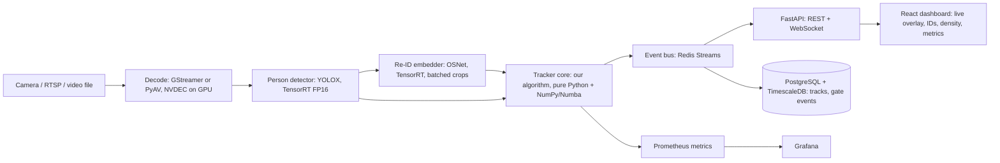

# PS-2 Tech Stack: Production-Grade, Real-Time, Scalable
*Zed Digital hackathon · prepared 4 Oct 2026*

**Design rule:** the *algorithm* is what wins; the stack must (1) let us iterate on the tracker fast, (2) prove real-time numbers, and (3) look like something Zed could drop into the ZIG gate pipeline. Keep the research core and the serving layer separate.

## 1. Architecture


## 2. Layer by layer
| Layer | Choice | Why | Alternative |
|---|---|---|---|
| Language | **Python 3.11** for core, C++ only if profiling demands it | Fast iteration, whole MOT ecosystem is Python | Rust/C++ port of the association step later |
| DL framework | **PyTorch 2.x** | Standard for YOLOX, OSNet, FastReID | — |
| Detector | **YOLOX-S/M/X** with ByteTrack's MOT17/MOT20 weights (CrowdHuman-trained) | Apache-2.0, same weights as the baselines, so the comparison is fair | RT-DETR; Ultralytics YOLO11 is strong but **AGPL-3.0**, so check licensing before a company handoff |
| Re-ID | **OSNet-x0.25/x1.0** (torchreid) or a FastReID SBS-R50 for the accuracy run | Compact = matches PS constraints; easy to export | CLIP-ReID for accuracy experiments only |
| Association | `scipy.optimize.linear_sum_assignment` / `lap` (`lapjv`), cost matrices in NumPy, hot loops in **Numba** | Hungarian is what the PS names; sub-ms for gate-scale crowds | — |
| Motion | Own Kalman filter (BoT-SORT-style `xywh` state) + optional ground-plane homography | We need to modify it (occlusion-aware noise), so own it | `filterpy` for reference |
| Inference runtime | **ONNX → TensorRT FP16** (INT8 as a stretch) | Proves "bounded latency"; 2–4× over eager PyTorch | ONNX Runtime CUDA EP as fallback; OpenVINO for CPU demo |
| Video I/O | **GStreamer** (NVDEC) or PyAV; RTSP input | Real camera-shaped input | NVIDIA DeepStream if we want a full Zed-style edge deploy |
| Evaluation | **TrackEval** (official HOTA/IDF1/MOTA), MOT17/MOT20/DanceTrack val | Judges trust official code only | — |
| Experiments | **Hydra** configs + **Weights & Biases** (or MLflow) | Every ablation is one config flag; reproducible tables | — |
| Serving API | **FastAPI** + Uvicorn, WebSocket for live tracks | Async, typed, auto docs; Zed already uses Python/Flask | — |
| Messaging | **Redis Streams** | Decouples tracker from consumers; low latency | Kafka at multi-gate scale |
| Storage | **PostgreSQL + TimescaleDB** | Track points and gate events are time series | — |
| Frontend | **React + Vite + TypeScript**, canvas overlay on the video | Zed uses React; clean live demo | — |
| Packaging | **Docker** (NVIDIA base image), docker-compose for the demo | One command to run | — |
| Scale-out | **Kubernetes** with one tracker pod per camera, GPU node pool, HPA on stream count | Matches Zed's K8s/Terraform stack; tracking is per camera so it shards cleanly | — |
| Observability | **Prometheus + Grafana** (FPS, per-stage latency p50/p95, active tracks, ID-switch proxy) | "Reliable" means measured | Datadog (Zed uses it) |
| Quality | pytest (unit tests on Kalman, cost matrix, lifecycle), ruff, mypy, GitHub Actions CI incl. a short TrackEval regression on one sequence | Catches metric regressions on every PR | — |

## 3. Repo layout
```
zed-ps2-tracker/
  tracker/            # the algorithm, framework-free
    kalman.py  cost.py  assignment.py  lifecycle.py  visibility.py  gallery.py
  models/             # detector + re-ID wrappers, export scripts (onnx/trt)
  eval/               # TrackEval runners, density/occlusion stress binning, plots
  configs/            # hydra: baselines/, ours/, ablations/
  serve/              # FastAPI app, Redis publisher, websocket
  dashboard/          # React UI
  deploy/             # Dockerfile, docker-compose.yml, k8s/
  tests/
  REPORT.md           # results tables, stress curves, failure gallery
```

## 4. Build order (so we always have something submittable)
1. **Day 1–2:** Data (MOT17, MOT20, DanceTrack) + TrackEval working; run ByteTrack and OC-SORT baselines with YOLOX weights, reproduce published-ballpark numbers.
2. **Day 3–5:** Our tracker skeleton (Kalman + Hungarian + lifecycle) matching ByteTrack; add re-ID.
3. **Day 6–10:** Novel components (visibility-aware cost, embedding freeze, occlusion state, ambiguity-aware assignment), one at a time with ablations.
4. **Day 11–12:** Stress analysis (density/occlusion bins, synthetic dropout), plots.
5. **Day 13–14:** TensorRT export, latency report, FastAPI + dashboard demo on a crowded-gate clip, Docker.
6. **Final:** report, demo video, README with one-command reproduction.

*(Compress or stretch to the real deadline once we have it.)*

## 5. Hardware
- Dev/training: any CUDA GPU with 8 GB or more (Colab/Kaggle T4 works for inference + re-ID fine-tuning; a 3090/4090/A100 if available).
- Report real-time numbers on a stated GPU **and** a Jetson-class or CPU number if possible, since Zed deploys on edge validators.

## 6. What *not* to do
- Don't build an end-to-end transformer tracker (MOTR family) from scratch; too slow to train, hard to ablate in time.
- Don't use offline tricks (global linking, interpolation) in the headline numbers; PS-2 requires online/causal. Report them separately if at all.
- Don't over-invest in the dashboard; it's the cherry, not the cake.
