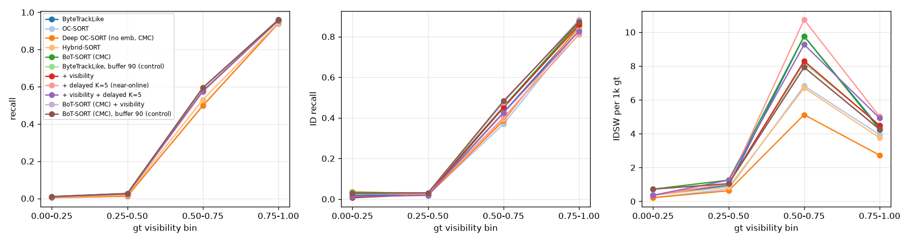
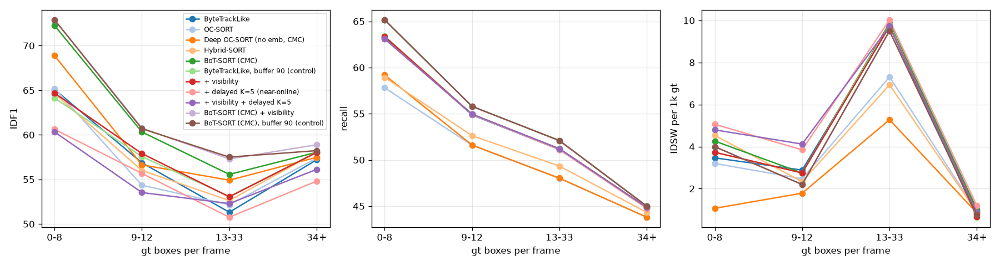

# Ablation (MOT17 val_half, public FRCNN detections, no re-ID)

Reproduce with `make ablate` (`eval/ablate.py`, manifest `configs/ablations/manifest.yaml`). Every
number below was measured on this box, CPU only. Latency is `eval.latency` (single-threaded,
`OMP_NUM_THREADS=1`, one warm-up and one timed pass, run one entry at a time). It is the time of
the tracker's `update()` alone: no detector, no I/O.

### Ablation: MOT17 val_half, public detections

| Group | Tracker | HOTA | IDF1 | MOTA | IDSW | AssA | DetA | p50 / p95 / max ms |
|---|---|---|---|---|---|---|---|---|
| baseline | ByteTrackLike | 50.1 | 56.3 | 47.5 | 191 | 58.3 | 43.3 | 0.93 / 1.89 / 3.0 |
| baseline | OC-SORT | 49.8 | 56.2 | 46.0 | 154 | 59.4 | 41.9 | 0.73 / 1.55 / 2.6 |
| baseline | Deep OC-SORT (no emb, CMC) | 50.6 | 57.6 | 46.2 | 112 | 61.1 | 42.0 | 0.97 / 2.23 / 4.0 |
| baseline | Hybrid-SORT | 50.2 | 56.9 | 46.5 | 152 | 59.5 | 42.4 | 1.20 / 2.66 / 4.6 |
| baseline | BoT-SORT (CMC) | 51.6 | 58.8 | 48.0 | 197 | 61.0 | 43.9 | 0.95 / 1.92 / 2.9 |
| control | ByteTrackLike, buffer 90 (control) | 51.0 | 57.2 | 47.6 | 183 | 60.4 | 43.3 | 1.18 / 2.72 / 3.8 |
| ours | + visibility | 51.0 | 57.3 | 47.6 | 183 | 60.4 | 43.3 | 1.07 / 2.19 / 3.6 |
| ours | + delayed K=5 (near-online) | 48.8 | 54.3 | 47.4 | 215 | 55.6 | 43.0 | 1.26 / 18.00 / 69.5 |
| ours | + visibility + delayed K=5 | 49.6 | 55.1 | 47.5 | 203 | 57.5 | 43.0 | 1.52 / 20.33 / 63.2 |
| ours | BoT-SORT (CMC) + visibility | 52.5 | 59.8 | 48.0 | 180 | 63.3 | 43.8 | 1.09 / 2.27 / 3.0 |
| control | BoT-SORT (CMC), buffer 90 (control) | 52.4 | 59.5 | 48.0 | 180 | 63.0 | 43.8 | 1.07 / 2.19 / 7.2 |

**Reading the table**
- **Visibility.** `+ visibility` (frozen on train_half) adds +0.9 HOTA on ByteTrackLike and +0.9 on
  BoT-SORT. The matching **controls**, a plain 90-frame lost buffer with no visibility, give the
  same numbers within 0.1 HOTA (51.0 vs 51.0; 52.5 vs 52.4). The gain comes from keeping lost
  tracks longer, not from the visibility estimate. The BoT-SORT + visibility row reuses the
  ByteTrackLike-tuned visibility settings without re-tuning.
- **Delayed decision.** `delayed K=5` lowers HOTA by 1.3 and adds 24 ID switches, and its p95
  compute time rises to 18 ms (max 70 ms), before the 5-frame algorithmic delay. See
  `docs/results/go_no_go.md`: it is an ablation, not a result.
- **Best on public detections.** BoT-SORT with CMC from files (51.6 HOTA). With the longer buffer,
  with or without visibility, it reaches 52.4–52.5. Deep OC-SORT has by far the fewest ID switches
  (112).
- All baselines match their upstream code frame for frame (`docs/results/parity/`). Public
  detections are not the detections the papers report on, so these are not paper numbers.

**Stress curves** (`stress_*.png`, from each run's `stress.json`):
- `stress_visibility.png`: recall, ID recall and IDSW per 1k gt boxes by gt visibility bin.
- `stress_density.png`: IDF1, recall and IDSW per 1k gt by gt boxes per frame.

The `=0` visibility subset is left out of the plots and kept in `ablation.json`. Below 0.5
visibility the public detector finds 1–4 % of people, so no tracker can do much there; the curves
mostly show detector coverage.

