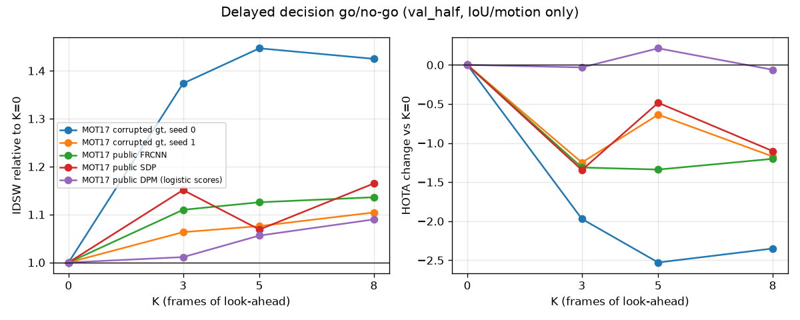

# Go/no-go: does the delayed decision reduce identity switches? **No-go.**

This is a sanity check (spec `06_phase2_specs.md`), **not a results table**. It compares
ByteTrack-style immediate matching (K = 0) with the K-frame look-ahead of `tracker/delayed.py`,
using IoU/motion only, on MOT17 **val_half**, at K = 0, 3, 5, 8 frames. Everything below was
measured on this box (CPU only) with `python -m eval.go_no_go`. Raw rows are in `go_no_go/*.json`.

## Verdict

**Flat to negative on every input. The delayed decision does not go into the pitch as a result.**
Per the spec, the pitch leads with the visibility estimate and the gate events, and the delayed
decision becomes an ablation. With the frozen v2 variant, every K > 0 run has **more** ID switches
than K = 0 on all five MOT17 inputs: corrupted gt with 2 seeds, and public FRCNN, SDP and DPM.
HOTA is lower or within ±0.2. The look-ahead also costs compute: p95 `update()` time rises from
2–4 ms to 13–157 ms, and that comes on top of the algorithmic delay of K/fps (119–318 ms on
average over the sequences).

One open question is whether the look-ahead score could be fixed. Two scoring flaws were found and
fixed on train_half (v1 → v2, below). At K = 3, v2 cut the extra switches over K = 0 on
corrupted gt seed 0 (+528 → +102), SDP (+90 → +44) and DPM (+33 → +1), but not on FRCNN
(+8 → +21). The damage did not go away. Our
working hypothesis, **not verified**, is this: once a Kalman track has taken a detection, it adapts
within 1–2 frames, so IoU-only look-ahead costs barely separate the hypotheses. Re-ID embeddings
(GPU) would give the look-ahead a real signal. That is listed in `docs/next_gpu_session.md`.

## Frozen variant v2 (`configs/ours/delayed.yaml`, chosen on train_half only)

| Condition | K (frames / ms) | HOTA | IDF1 | IDSW (TrackEval) | IDSW in K=0 windows | IDSW in own windows | flagged frames | changed | p95 / max ms |
|---|---|---|---|---|---|---|---|---|---|
| MOT17 corrupted gt, seed 0 | 0 / 0 | 55.4 | 67.6 | 273 | 374 | 374 | 1816 | 0 | 4.3 / 5 |
| MOT17 corrupted gt, seed 0 | 3 / 119 | 53.5 | 64.7 | 375 | 473 | 473 | 1817 | 129 | 76.8 / 164 |
| MOT17 corrupted gt, seed 0 | 5 / 199 | 52.9 | 64.5 | 395 | 484 | 484 | 1809 | 148 | 105.3 / 247 |
| MOT17 corrupted gt, seed 0 | 8 / 318 | 53.1 | 64.7 | 389 | 505 | 505 | 1815 | 147 | 152.9 / 390 |
| MOT17 corrupted gt, seed 1 | 0 / 0 | 54.7 | 66.1 | 316 | 423 | 423 | 1746 | 0 | 4.3 / 5 |
| MOT17 corrupted gt, seed 1 | 3 / 119 | 53.4 | 65.2 | 336 | 455 | 455 | 1745 | 106 | 74.5 / 172 |
| MOT17 corrupted gt, seed 1 | 5 / 199 | 54.1 | 66.1 | 340 | 470 | 470 | 1746 | 114 | 104.7 / 295 |
| MOT17 corrupted gt, seed 1 | 8 / 318 | 53.5 | 64.8 | 349 | 476 | 476 | 1739 | 117 | 156.6 / 376 |
| MOT17 public FRCNN | 0 / 0 | 50.1 | 56.3 | 191 | 192 | 192 | 635 | 0 | 2.6 / 5 |
| MOT17 public FRCNN | 3 / 119 | 48.8 | 54.4 | 212 | 213 | 211 | 625 | 42 | 13.0 / 58 |
| MOT17 public FRCNN | 5 / 199 | 48.8 | 54.3 | 215 | 218 | 216 | 626 | 45 | 17.8 / 58 |
| MOT17 public FRCNN | 8 / 318 | 48.9 | 54.6 | 217 | 218 | 216 | 622 | 49 | 25.3 / 79 |
| MOT17 public SDP | 0 / 0 | 56.2 | 67.2 | 291 | 346 | 346 | 1217 | 0 | 3.4 / 9 |
| MOT17 public SDP | 3 / 119 | 54.9 | 65.0 | 335 | 386 | 386 | 1207 | 117 | 29.1 / 144 |
| MOT17 public SDP | 5 / 199 | 55.8 | 66.3 | 311 | 367 | 367 | 1203 | 111 | 41.7 / 200 |
| MOT17 public SDP | 8 / 318 | 55.1 | 65.5 | 339 | 401 | 401 | 1202 | 120 | 57.9 / 258 |
| MOT17 public DPM (logistic scores) | 0 / 0 | 31.7 | 38.6 | 89 | 124 | 124 | 874 | 0 | 1.9 / 3 |
| MOT17 public DPM (logistic scores) | 3 / 119 | 31.7 | 38.4 | 90 | 133 | 133 | 857 | 34 | 13.7 / 62 |
| MOT17 public DPM (logistic scores) | 5 / 199 | 31.9 | 38.8 | 94 | 131 | 131 | 871 | 38 | 19.4 / 56 |
| MOT17 public DPM (logistic scores) | 8 / 318 | 31.6 | 38.5 | 97 | 132 | 132 | 869 | 40 | 28.6 / 103 |

How to read the columns:
- **IDSW (TrackEval)**: over all frames.
- **IDSW in K=0 windows / own windows**: our own CLEAR-style count (gt pedestrians, IoU ≥ 0.5) of
  the switches that fall within ±8 frames of a frame where the ambiguity detector fired, in the
  K = 0 run or in the run itself. That count is higher than TrackEval's over all frames: for
  example 374 vs 273, because TrackEval's CLEAR matching prefers to continue previous matches and
  ours does not. Use it only to compare across K.
- **The windows are not selective.** The detector fires on 24–69 % of frames (`flagged frames`, out
  of 2652), so the windows hold nearly all switches. The windows-only count therefore says the same
  as the all-frames count.
- **changed**: decisions where the look-ahead overrode the immediate solver.
- **K ms**: K / fps averaged over sequences (MOT17 val sequences run at 30, 25 and 14 fps).
- **p95 / max**: per-`update()` compute time of the delayed tracker, measured during 7 parallel
  runs. It excludes the K-frame algorithmic delay.

## v1, the first frozen variant (score over the cluster's tracks only)

v1 was frozen from the public-FRCNN train_half sweep and run once on val_half; it was much worse:

| Condition | K (frames / ms) | HOTA | IDF1 | IDSW (TrackEval) | IDSW in K=0 windows | IDSW in own windows | flagged frames | changed | p95 / max ms |
|---|---|---|---|---|---|---|---|---|---|
| MOT17 corrupted gt, seed 0 | 0 / 0 | 55.4 | 67.6 | 273 | 374 | 374 | 1816 | 0 | 4.3 / 5 |
| MOT17 corrupted gt, seed 0 | 3 / 119 | 48.1 | 56.6 | 801 | 1015 | 1015 | 1829 | 542 | 198.4 / 394 |
| MOT17 corrupted gt, seed 0 | 5 / 199 | 48.1 | 56.8 | 859 | 1061 | 1061 | 1831 | 568 | 284.9 / 530 |
| MOT17 corrupted gt, seed 0 | 8 / 318 | 47.0 | 54.6 | 872 | 1114 | 1115 | 1827 | 595 | 410.2 / 780 |
| MOT17 corrupted gt, seed 1 | 0 / 0 | 54.7 | 66.1 | 316 | 423 | 423 | 1746 | 0 | 4.2 / 5 |
| MOT17 corrupted gt, seed 1 | 3 / 119 | 49.1 | 57.9 | 786 | 1022 | 1022 | 1748 | 544 | 193.1 / 421 |
| MOT17 corrupted gt, seed 1 | 5 / 199 | 48.5 | 57.8 | 870 | 1096 | 1096 | 1754 | 583 | 287.5 / 575 |
| MOT17 corrupted gt, seed 1 | 8 / 318 | 47.2 | 55.4 | 915 | 1146 | 1146 | 1759 | 629 | 407.3 / 734 |
| MOT17 public FRCNN | 0 / 0 | 50.1 | 56.3 | 191 | 192 | 192 | 635 | 0 | 2.5 / 4 |
| MOT17 public FRCNN | 3 / 119 | 49.7 | 55.6 | 199 | 197 | 197 | 634 | 52 | 26.6 / 89 |
| MOT17 public FRCNN | 5 / 199 | 49.5 | 55.5 | 207 | 209 | 207 | 634 | 66 | 37.9 / 94 |
| MOT17 public FRCNN | 8 / 318 | 49.7 | 55.7 | 213 | 213 | 213 | 636 | 86 | 52.5 / 124 |
| MOT17 public SDP | 0 / 0 | 56.2 | 67.2 | 291 | 346 | 346 | 1217 | 0 | 3.4 / 5 |
| MOT17 public SDP | 3 / 119 | 55.6 | 66.1 | 381 | 447 | 447 | 1215 | 202 | 67.9 / 177 |
| MOT17 public SDP | 5 / 199 | 55.6 | 65.5 | 417 | 484 | 484 | 1207 | 220 | 97.7 / 297 |
| MOT17 public SDP | 8 / 318 | 55.4 | 65.5 | 473 | 548 | 548 | 1204 | 248 | 141.5 / 404 |
| MOT17 public DPM (logistic scores) | 0 / 0 | 31.7 | 38.6 | 89 | 124 | 124 | 874 | 0 | 2.0 / 3 |
| MOT17 public DPM (logistic scores) | 3 / 119 | 31.8 | 38.9 | 122 | 177 | 177 | 981 | 92 | 35.8 / 97 |
| MOT17 public DPM (logistic scores) | 5 / 199 | 31.8 | 38.8 | 141 | 187 | 187 | 1010 | 102 | 50.8 / 159 |
| MOT17 public DPM (logistic scores) | 8 / 318 | 31.2 | 37.9 | 148 | 199 | 201 | 1027 | 115 | 75.9 / 188 |

**Why v1 was worse.** v1 scored a hypothesis only by the costs of the cluster's own tracks. A
hypothesis that hands a cluster track the detection of a track outside the cluster therefore paid
nothing for the damage. v2 scores every first-association track, adds a birth penalty and only
considers re-assignments (`same_tracks`). The v2 sweep used separate corrupted-gt data (seed 100)
on train_half: `go_no_go/tune_train_half.md`. Running v1 on val_half came before v2 was designed,
so v2 is not a blind second test. It is still worse than K = 0, and the verdict does not depend on
which variant is used.

## Inputs

- **Corrupted gt** (`eval/corrupt.py`, seeds 0 and 1). Every gt pedestrian box is dropped with
  p = 0.05 + 0.5·(1 − visibility), jittered (centre σ = 4 % of w/h, size σ = 4 % log) and scored
  0.5 + 0.5·v + N(0, 0.1). Poisson(2) false positives are added per frame with scores from
  U(0.1, 0.6).
- **MOT17 public detections** FRCNN, SDP and DPM. DPM scores are unbounded (about −0.5 to 4.8),
  so they are mapped with a logistic `1/(1+e^−s)` (`eval.run --score-map logistic`). The
  ByteTrack thresholds then act on the mapped values, which explains DPM's low HOTA at every K.

## MOT20 (corrupted gt, seed 0): K > 0 did not finish

K = 0 ran in 76 s: HOTA 48.7, IDF1 58.2, MOTA 63.0, IDSW 5140. The ambiguity detector fired on
4454 of 4463 val frames, and p95 `update()` was 20.8 ms. The K = 3, 5 and 8 runs had not finished
after 40 minutes (with v1, K = 3 had not finished after 30 minutes), and were stopped. With more than 100 people per frame, the
per-cluster rollouts make the look-ahead impractical on CPU in this form. **No MOT20 K > 0 numbers
exist.** The MOT20 public detections (`det.txt`) were not run: their scores are almost all 0 or 1,
which breaks the score thresholds (phase-1 note).
